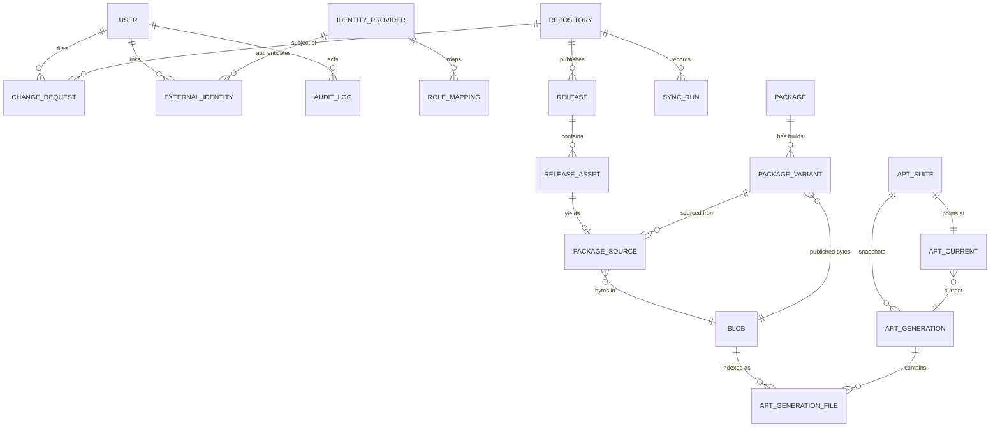
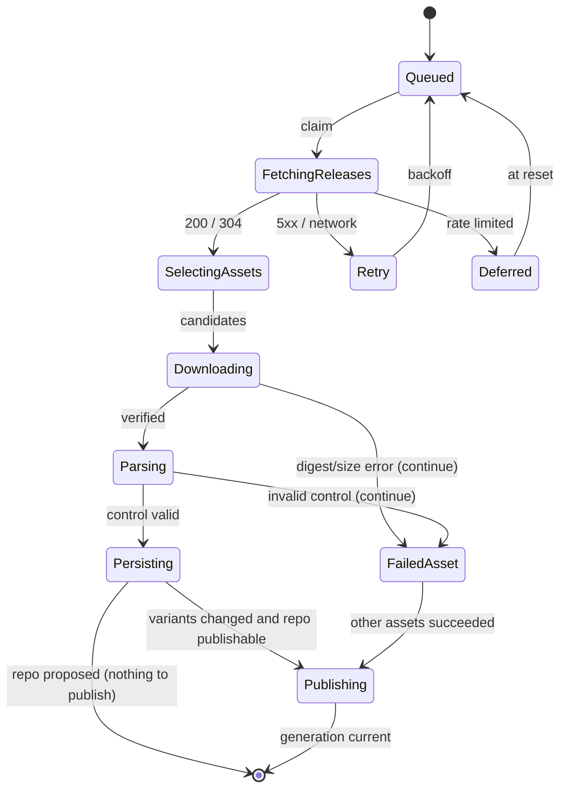
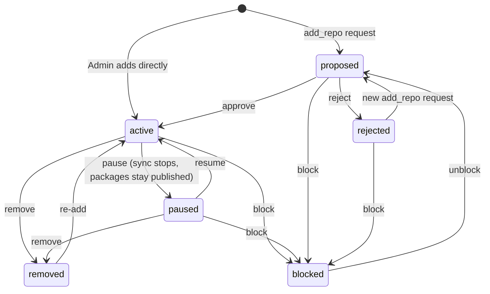

# RepoCuck — Implementation Specification

| Field | Value |
| --- | --- |
| Status | v1.1 — implemented in RepoCuck 1.0 (deviations: Appendix E) |
| Date | 2026-10-24 |
| Target | .NET 10 (LTS), PostgreSQL 17+, Linux containers |
| Companion | [`PLAN.md`](./PLAN.md) |
| Normative language | `MUST` / `MUST NOT` / `SHOULD` per RFC 2119 |

This document is the buildable specification for RepoCuck. It defines the data model,
algorithms, interfaces, configuration, security controls and tests. Where the plan states a
requirement (`FR-*`, `NFR-*`), this document states how it is met.

### Contents

1. [Scope and terminology](#1-scope-and-terminology)
2. [Solution architecture](#2-solution-architecture)
3. [Domain model](#3-domain-model)
4. [Debian artefact handling](#4-debian-artefact-handling)
5. [Ingestion pipeline](#5-ingestion-pipeline)
6. [Requests, curation and retention](#6-requests-curation-and-retention)
7. [APT repository generation and serving](#7-apt-repository-generation-and-serving)
8. [Identity and access](#8-identity-and-access)
9. [Web UI](#9-web-ui)
10. [HTTP API](#10-http-api)
11. [Configuration](#11-configuration)
12. [Deployment](#12-deployment)
13. [Security controls](#13-security-controls)
14. [Observability and operations](#14-observability-and-operations)
15. [Test strategy](#15-test-strategy)
16. [Traceability and acceptance](#16-traceability-and-acceptance)
17. [Appendices](#17-appendices)

---

## 1. Scope and terminology

| Term | Meaning |
| --- | --- |
| **Repository** | The unique server-side record of a watched GitHub repository, keyed by GitHub's numeric repo ID. Shared by everyone. |
| **Request** | A Member's (or Admin's) proposal to add a repository (`add_repo`) or add architectures to one (`add_arch`). Decided by an Admin. |
| **Release** | A GitHub release (tag + assets). |
| **Asset** | A file attached to a release. Only `.deb` files are ingested. |
| **Variant** | One publishable `(package name, version, architecture)` build, with its control metadata and blob. |
| **Source** | A `(variant, asset, repository, blob)` provenance link. Exactly one source is the winner for each variant; others are alternates. |
| **Suite** | APT distribution (`stable`, `testing`). |
| **Component** | APT component under a suite (`main`). |
| **Generation** | An immutable, signed snapshot of all indices for one suite. |
| **Pool file** | An immutable `.deb` served under `/apt/pool/...`. |
| **Publishable repository** | A repository in state `active`, `paused`, or `removed` within its grace period. |
| **Quarantine** | (a) A `proposed` repository: fetched and inspected, never published. (b) A variant held back by policy until an Admin releases it. |

---

## 2. Solution architecture

### 2.1 Projects

```
RepoCuck.sln
src/
  RepoCuck.Domain/          entities, enums, DebianVersion, policies, invariants
  RepoCuck.Application/     use cases, ports (IGitHubClient, IBlobStore, ISigner), jobs
  RepoCuck.Infrastructure/  EF Core, Npgsql, GitHub HTTP client, filesystem blob store, gpg signer
  RepoCuck.Debian/          ar reader, control parser, Packages/Release writer, pool naming
  RepoCuck.Web/             host: Razor Pages, minimal APIs, auth, /apt endpoints, workers
tests/
  RepoCuck.UnitTests/
  RepoCuck.IntegrationTests/   Testcontainers Postgres + WireMock GitHub
  RepoCuck.E2E/                compose stack + real apt clients
  RepoCuck.LoadTests/
deploy/
  Dockerfile
  docker-compose.yml           (cloudflared variant)
  docker-compose.caddy.yml     (Caddy variant)
  Caddyfile
```

Dependency rule: `Web → Application → Domain`; `Infrastructure`/`Debian` implement
`Application` ports and are composed only in `Web`. No cyclic references. Domain has no
framework dependencies.

### 2.2 Process roles

`REPOCUCK__ROLE` selects hosted services:

| Role | Web | Sync worker | Publisher | Maintenance | Status |
| --- | --- | --- | --- | --- | --- |
| `all` (default) | ✓ | ✓ | ✓ | ✓ | supported |
| `web` | ✓ | ✗ | ✗ | ✗ | experimental; needs shared `/data` |
| `worker` | ✗ (health only) | ✓ | ✓ | ✓ | experimental; needs shared `/data` |

Publishing is guarded by PostgreSQL advisory lock key `hashtext('repocuck:apt-publish')`. In
split mode the web process refreshes its cached `apt_current` pointers by polling every 5 s.

### 2.3 Request pipeline order

1. Forwarded headers (trusted proxies only; see §12.3)
2. Exception handler → RFC 9457 problem details (no stack traces)
3. Scheme enforcement (§12.3) and security headers (HSTS only when `PublicScheme=https`)
4. Rate limiter
5. Authentication
6. Authorisation
7. Antiforgery / CSRF validation for mutating requests
8. Endpoint

---

## 3. Domain model

### 3.1 Entity relationship overview



### 3.2 Schema (PostgreSQL)

Use UUIDv7 primary keys generated in the application; `citext` for case-insensitive identity;
all timestamps `timestamptz` in UTC.

```sql
create extension if not exists citext;

-- ---------------------------------------------------------------- identity
create table users (
    id                    uuid primary key,
    username              citext not null unique,
    email                 citext,
    display_name          text   not null,
    password_hash         text,                          -- null => SSO-only account
    role                  text   not null check (role in ('admin','member')),
    role_locked           boolean not null default false,
    is_active             boolean not null default true, -- accounts are disabled, never hard-deleted
    must_change_password  boolean not null default false,
    totp_secret_enc       bytea,
    totp_enabled          boolean not null default false,
    totp_last_counter     bigint,
    recovery_codes_hash   text[] not null default '{}',
    failed_login_count    integer not null default 0,
    lockout_until         timestamptz,
    security_stamp        uuid not null,
    created_at            timestamptz not null default now(),
    updated_at            timestamptz not null default now(),
    last_login_at         timestamptz
);

create table identity_providers (
    id                uuid primary key,
    slug              text not null unique check (slug ~ '^[a-z0-9][a-z0-9-]{1,30}$'),
    display_name      text not null,
    authority         text not null,             -- https://idp.example.com/realms/main
    client_id         text not null,
    client_secret_enc bytea,                     -- Data Protection-encrypted; set via admin UI
    client_secret_file text,                     -- alternative: path to a mounted secret file
    scopes            text not null default 'openid profile email',
    group_claim       text not null default 'groups',
    username_claim    text not null default 'preferred_username',
    email_claim       text not null default 'email',
    auto_provision    boolean not null default true,
    require_verified_email boolean not null default true,
    enabled           boolean not null default true,
    created_at        timestamptz not null default now()
);

create table role_mappings (
    id          uuid primary key,
    provider_id uuid not null references identity_providers(id) on delete cascade,
    claim_value text not null,
    role        text not null check (role in ('admin','member')),
    priority    integer not null default 0,
    unique (provider_id, claim_value)
);

create table external_identities (
    id             uuid primary key,
    user_id        uuid not null references users(id) on delete cascade,
    provider_id    uuid not null references identity_providers(id) on delete cascade,
    subject        text not null,
    email          citext,
    email_verified boolean not null default false,
    created_at     timestamptz not null default now(),
    last_login_at  timestamptz,
    unique (provider_id, subject)
);

-- ---------------------------------------------------------------- repositories & requests
create table repositories (
    id                     uuid primary key,
    github_repo_id         bigint not null unique,
    owner                  text not null,
    name                   text not null,
    full_name              citext not null,           -- display only; NOT unique (see §6.1)
    html_url               text not null,
    description            text,
    notes                  text,                      -- admin-editable
    license_spdx           text,
    default_branch         text,
    is_archived            boolean not null default false,
    state                  text not null default 'proposed'
                           check (state in ('proposed','active','paused','removed','rejected','blocked')),
    state_reason           text,                      -- shown to all users (rejected/blocked/removed)
    architectures          text[] not null default '{}'
                           check (cardinality(architectures) <= 8),
    source_priority        integer not null default 0,
    include_prereleases    boolean not null default false,
    holdback_hours         integer not null default 0 check (holdback_hours between 0 and 720),
    asset_include_glob     text not null default '*.deb',
    asset_exclude_glob     text,
    max_asset_bytes        bigint,
    sync_interval_minutes  integer not null default 30
                           check (sync_interval_minutes between 5 and 1440),
    next_sync_at           timestamptz,
    conditional_etag       text,
    last_synced_at         timestamptz,
    last_sync_status       text,
    consecutive_failures   integer not null default 0,
    proposed_by            uuid references users(id),
    approved_by            uuid references users(id),
    approved_at            timestamptz,
    removed_at             timestamptz,
    created_at             timestamptz not null default now(),
    updated_at             timestamptz not null default now()
);
create index repositories_full_name on repositories (lower(full_name));
create index repositories_due on repositories (next_sync_at)
    where state = 'active';
create index repositories_state on repositories (state);

create table change_requests (
    id            uuid primary key,
    kind          text not null check (kind in ('add_repo','add_arch')),
    repository_id uuid not null references repositories(id),
    requested_by  uuid not null references users(id),
    architectures text[] not null check (cardinality(architectures) between 1 and 8),
    note          text check (char_length(note) <= 1000),
    status        text not null default 'pending'
                  check (status in ('pending','approved','rejected','cancelled')),
    decided_by    uuid references users(id),
    decided_at    timestamptz,
    decision_note text check (char_length(decision_note) <= 500),
    created_at    timestamptz not null default now()
);
create unique index change_requests_one_pending
    on change_requests (repository_id, requested_by, kind) where status = 'pending';
create index change_requests_status on change_requests (status, created_at);
create index change_requests_user on change_requests (requested_by, created_at desc);

-- ---------------------------------------------------------------- ingestion
create table releases (
    id                   uuid primary key,
    repository_id        uuid not null references repositories(id) on delete cascade,
    github_release_id    bigint not null,
    tag_name             text not null,
    name                 text,
    body                 text,
    is_prerelease        boolean not null default false,
    is_draft             boolean not null default false,
    published_at         timestamptz,
    html_url             text,
    download_count_total bigint not null default 0,
    observed_at          timestamptz not null default now(),
    unique (repository_id, github_release_id)
);

create table release_assets (
    id              uuid primary key,
    release_id      uuid not null references releases(id) on delete cascade,
    github_asset_id bigint not null unique,
    name            text not null,
    size_bytes      bigint not null,
    content_type    text,
    digest_sha256   text,                -- GitHub-provided, if any
    download_count  bigint not null default 0,
    source_url      text not null,
    state           text not null default 'discovered'
                    check (state in ('discovered','downloaded','parsed','excluded',
                                     'failed','quarantined')),
    excluded_reason text,                -- e.g. arch_not_selected:arm64 (re-evaluated on arch change)
    failure_reason  text,
    observed_at     timestamptz not null default now()
);
create index release_assets_release on release_assets (release_id);

create table blobs (
    id                uuid primary key,
    sha256            text not null unique,
    sha512            text not null,
    size_bytes        bigint not null,
    storage_key       text not null,
    content_type      text not null,
    is_index          boolean not null default false,
    created_at        timestamptz not null default now(),
    last_referenced_at timestamptz not null default now()
);

create table packages (
    id            uuid primary key,
    name          text not null,
    name_lower    text generated always as (lower(name)) stored unique,
    first_seen_at timestamptz not null default now()
);

create table package_variants (
    id              uuid primary key,
    package_id      uuid not null references packages(id),
    version         text not null,
    architecture    text not null check (architecture ~ '^[a-z0-9][a-z0-9-]*$'),
    channel         text not null check (channel in ('stable','prerelease')),
    control         json not null,           -- sanitised control fields, order preserved
    description     text not null,
    filename        text not null,           -- pool filename of the *current winner's* bytes
    size_bytes      bigint not null,
    sha256          text not null,
    sha512          text not null,
    blob_id         uuid not null references blobs(id),
    state           text not null default 'active'
                    check (state in ('active','quarantined','tombstoned')),
    quarantine_reason text,                  -- reserved_name | epoch | admin | ...
    publish_after   timestamptz,             -- release holdback
    first_seen_at   timestamptz not null default now(),
    published_at    timestamptz,
    unique (package_id, version, architecture),
    unique (filename)
);
create index package_variants_publish on package_variants (channel, architecture)
    where state = 'active';

create table package_sources (
    id            uuid primary key,
    variant_id    uuid not null references package_variants(id) on delete cascade,
    asset_id      uuid not null unique references release_assets(id),
    repository_id uuid not null references repositories(id) on delete cascade,
    blob_id       uuid not null references blobs(id),   -- this source's own bytes
    is_winner     boolean not null default false,
    created_at    timestamptz not null default now()
);
create unique index package_sources_one_winner
    on package_sources (variant_id) where is_winner;
create index package_sources_repo on package_sources (repository_id);

-- Immutable pool filename registry: a name is never reused with different bytes.
create table pool_files (
    component  text not null default 'main',
    filename   text not null,
    sha256     text not null,
    size_bytes bigint not null,
    created_at timestamptz not null default now(),
    primary key (component, filename)
);

-- ---------------------------------------------------------------- apt output
create table apt_suites (
    id                 uuid primary key,
    name               text not null unique check (name in ('stable','testing')),
    component          text not null default 'main',
    include_prereleases boolean not null default false,
    is_enabled         boolean not null default true,
    not_automatic      boolean not null default false,
    origin             text not null default 'RepoCuck',
    label              text not null default 'RepoCuck',
    description        text not null default 'RepoCuck curated APT repository',
    valid_until_days   integer not null default 7 check (valid_until_days between 1 and 30),
    retain_generations integer not null default 5 check (retain_generations between 2 and 50),
    retain_hours       integer not null default 48 check (retain_hours between 6 and 720)
);

create table apt_generations (
    id                 uuid primary key,
    suite_id           uuid not null references apt_suites(id),
    generation_no      bigint not null,
    status             text not null check (status in ('building','signed','superseded','failed')),
    release_blob_id    uuid references blobs(id),
    inrelease_blob_id  uuid references blobs(id),
    release_gpg_blob_id uuid references blobs(id),
    package_count      integer not null default 0,
    created_at         timestamptz not null default now(),
    activated_at       timestamptz,
    unique (suite_id, generation_no)
);

create table apt_generation_files (
    generation_id uuid not null references apt_generations(id) on delete cascade,
    path          text not null,           -- relative to /dists/<suite>/
    blob_id       uuid not null references blobs(id),
    sha256        text not null,
    size_bytes    bigint not null,
    primary key (generation_id, path)
);

-- The single source of truth for "which generation is live".
create table apt_current (
    suite_id      uuid primary key references apt_suites(id),
    generation_id uuid not null references apt_generations(id),
    updated_at    timestamptz not null default now()
);

-- ---------------------------------------------------------------- jobs/ops
create table jobs (
    id          uuid primary key,
    kind        text not null,
    payload     jsonb not null default '{}',
    dedupe_key  text,
    state       text not null default 'pending'
                check (state in ('pending','running','succeeded','failed','dead')),
    attempts    integer not null default 0,
    max_attempts integer not null default 5,
    run_after   timestamptz not null default now(),
    locked_by   text,
    locked_until timestamptz,
    last_error  text,
    created_at  timestamptz not null default now(),
    updated_at  timestamptz not null default now()
);
-- Only one *pending* job per key; a running job does not block enqueueing the next one
-- (the claim query refuses to start a job while another with the same key is running).
create unique index jobs_dedupe_pending on jobs (dedupe_key)
    where state = 'pending' and dedupe_key is not null;
create index jobs_ready on jobs (run_after) where state = 'pending';

create table sync_runs (
    id                uuid primary key,
    repository_id     uuid not null references repositories(id) on delete cascade,
    trigger           text not null check (trigger in ('schedule','manual','webhook','bootstrap','quarantine')),
    started_at        timestamptz not null default now(),
    finished_at       timestamptz,
    status            text not null default 'running'
                      check (status in ('running','succeeded','partial','failed')),
    releases_seen     integer not null default 0,
    assets_seen       integer not null default 0,
    assets_ingested   integer not null default 0,
    assets_excluded   integer not null default 0,
    assets_failed     integer not null default 0,
    variants_created  integer not null default 0,
    conflicts_found   integer not null default 0,
    error_category    text,
    error             text
);
create index sync_runs_repo on sync_runs (repository_id, started_at desc);

create table audit_log (
    id            bigserial primary key,
    occurred_at   timestamptz not null default now(),
    actor_user_id uuid references users(id),
    actor_label   text,
    actor_ip      inet,
    action        text not null,
    target_type   text,
    target_id     text,
    outcome       text not null default 'success'
                  check (outcome in ('success','failure','denied')),
    metadata      jsonb not null default '{}',
    correlation_id text
);
create index audit_log_time on audit_log (occurred_at desc);
create index audit_log_actor on audit_log (actor_user_id, occurred_at desc);

create table github_cache (
    cache_key  text primary key,
    etag       text,
    payload    jsonb,
    fetched_at timestamptz not null default now(),
    expires_at timestamptz
);

create table settings (
    key        text primary key,
    value      jsonb not null,
    updated_at timestamptz not null default now(),
    updated_by uuid references users(id)
);
```

Immutability enforcement:

```sql
create function deny_mutation() returns trigger language plpgsql as $$
begin
    raise exception 'table % is append-only', tg_table_name;
end $$;

create trigger audit_log_immutable
    before update or delete on audit_log
    for each row execute function deny_mutation();
```

The application DB role has `INSERT, SELECT` on `audit_log` and no `UPDATE/DELETE`; migrations
run under a separate owner role. Users are never hard-deleted (their `is_active` flag is
cleared and credentials removed), so audit and request history keep valid references.

### 3.3 Invariants

| ID | Invariant | Enforcement |
| --- | --- | --- |
| INV-1 | One canonical repository per GitHub repo ID | `repositories.github_repo_id UNIQUE` |
| INV-2 | At most one pending request per (repository, requester, kind) | partial unique index |
| INV-3 | One variant per (package, version, architecture) | unique index |
| INV-4 | Exactly one winning source per variant | partial unique index |
| INV-5 | Exactly one current generation per suite | `apt_current` primary key |
| INV-6 | A pool filename never changes bytes | `pool_files` check at publish |
| INV-7 | Published bytes for a version change only via explicit Admin re-arbitration or winner ineligibility (promotion) | arbitration rules (§6.4) |
| INV-8 | Audit rows are append-only | trigger + grants |
| INV-9 | Only publishable repositories contribute to any index | publisher filter (§7.2) |
| INV-10 | At least one enabled Admin exists | application guard inside the transaction |
| INV-11 | Nothing from a `proposed`, `rejected` or `blocked` repository is published | publisher filter (§7.2) |

---

## 4. Debian artefact handling

### 4.1 `.deb` container structure

```
!<arch>\n                          global header (8 bytes)
debian-binary/      2.0\n          ar member
control.tar.xz                    ar member (control metadata)
data.tar.xz                       ar member (payload; never extracted)
```

Each ar member header is 60 bytes: `name[16] mtime[12] uid[6] gid[6] mode[8] size[10] magic[2]`.
Members are 2-byte aligned. `RepoCuck.Debian.ArReader` MUST:

- verify the global header;
- accept names terminated with `/` (GNU) and BSD-style `#1/<len>` only if the length is sane;
- read member sizes as decimal ASCII and reject non-numeric or negative values;
- cap member count (16) and member size (asset size cap + 1 MiB);
- stream and skip `data.tar.*` without parsing or decompressing it;
- reject trailing garbage after the last member only if it is non-zero.

`debian-binary` MUST contain `2.0\n`; other versions are rejected.

### 4.2 Control metadata extraction

`control.tar.{gz,xz,zst,bz2}` is decompressed into a bounded stream. Decompression libraries:
gzip via `System.IO.Compression`, xz and bzip2 via SharpCompress (read-only use), zstd via
ZstdSharp.

| Limit | Value |
| --- | --- |
| Compressed control archive | 8 MiB |
| `./control` file | 256 KiB |
| Total decompressed bytes | 16 MiB |
| Compression ratio | 200:1 |
| Tar entries | 64 |

Read `./control` (also accept `control`), parse RFC 822:

- `Name: value`; continuation lines start with space or tab and are appended with a single
  space (descriptions preserve paragraph breaks as `.`);
- field names match `^[A-Za-z0-9][A-Za-z0-9-]*$`;
- values MUST NOT contain NUL, CR, or other C0 controls except TAB; LF only as continuation;
- maximum 100 fields, 8 KiB per value.

**Required fields**: `Package`, `Version`, `Architecture`, `Description`. `Maintainer` is
`SHOULD`: many packagers (goreleaser/nfpm) emit it empty or omit it, so a missing Maintainer is
accepted, logged as a warning on the asset and omitted from the index. Missing required fields
→ asset `failed` with reason `invalid_control`, shown on the repository page as a skipped
asset (no stack traces).

**Validation**

| Field | Rule |
| --- | --- |
| `Package` | `^[a-z0-9][a-z0-9+.-]+$`, ≤ 100 chars (Debian policy: lowercase only, ≥ 2 chars) |
| `Version` | `^[0-9][A-Za-z0-9.+~:-]*$`, ≤ 128 chars, valid epoch `^[0-9]+:` if present; reject empty upstream/revision segments |
| `Architecture` | `all` or `^[a-z0-9][a-z0-9-]*$`; reject `source`, `any`, `@` |
| `Installed-Size` | unsigned integer or absent |
| `Multi-Arch` | one of `no`, `same`, `foreign`, `allowed` |
| Dependencies | ≤ 16 KiB; no NUL/CR; validated only syntactically (do not resolve) |

**Sanitisation**

- Drop and recompute: `Filename`, `Size`, `MD5sum`, `SHA1`, `SHA256`, `SHA512`,
  `Description-md5`, `Status`, `Config-Version`, `Conffiles`, `Tag`.
- Reject fields whose name collides case-insensitively with the above.
- Strip surrounding whitespace; collapse repeated spaces in single-line values; keep
  description continuation formatting.
- Never trust `Source` to point outside the pool: emit it as metadata only.

The sanitised field map is stored as `package_variants.control` (JSON object preserving order)
and is the only source for index generation. Raw upstream control is not retained.

### 4.3 Package policy checks

Control sanitisation does not make a hostile package safe: maintainer scripts run as root on
clients. These checks are the second line of defence after the approval gate. A variant that
trips a check is created in state `quarantined` with `quarantine_reason`, appears in the
Admin's quarantine view and is never published until an Admin releases it (audited).

| Check | Rule | Setting |
| --- | --- | --- |
| Reserved names | `Package` (or any name in `Provides`, `Replaces`, `Conflicts`, `Breaks`) matches the reserved-name list | `Policy:ReservedNames` (static list shipped for distro-critical packages, e.g. `libc6`, `openssh-server`, `apt`, `dpkg`, `systemd`, `sudo`; Admin can import names from Debian/Ubuntu `Packages` indices and add/remove entries) |
| Epoch | Version carries an epoch ≥ 1 | `Policy:AllowEpoch` (default `false`) |
| Holdback | New release younger than `holdback_hours` | per repository; sets `publish_after` rather than quarantine |

Proposed repositories are subject to the same checks (so the Admin sees the flags before
approving). The landing page recommends an apt pin (§7.7) so that distro packages win over
RepoCuck packages with the same name.

### 4.4 Architecture rules

1. `Architecture` comes from control, never the filename (`foo_amd64.deb` may contain `arm64`;
   a mismatch is logged as `arch_mismatch` at Debug and control wins).
2. `all` is accepted for any repository and merged into every enabled architecture index.
3. A variant is **publishable for a suite** iff (its architecture is `all` or is in its
   winner repository's `architectures`), its channel is included by the suite, and its
   repository is publishable.
4. Assets whose architecture is outside the repository's set are recorded
   `excluded` / `arch_not_selected:<arch>` and their bytes are discarded. When an Admin adds
   architectures to a repository, a sync with `reevaluate=true` re-downloads the excluded
   assets of the most recent releases (bounded by `InitialBackfillReleases`).
5. Effective architecture set = `allow_list ∩ ⋃(architectures of publishable repositories)`,
   plus `all`.
6. `Release: Architectures` lists the effective set (including `all`). An index is generated
   for every advertised architecture, even when empty; an architecture is never advertised
   without a corresponding `binary-<arch>/Packages`.

### 4.5 Pool naming

```csharp
static string PoolPrefix(string package)
    => package.StartsWith("lib", StringComparison.Ordinal) && package.Length > 3
        ? package[..4]
        : package[..1];

string path = $"pool/{component}/{prefix}/{package}/{filename}";
```

Filename: `{package}_{versionWithoutEpoch}_{arch}.deb`, with `/` and `:` replaced by `_`,
lowercased, length ≤ 200. If `pool_files` already contains the filename with different bytes,
append `+{sha256[..8]}` before `.deb` (retry up to 3 times). `Filename` in the index always
matches the served path minus the repo prefix.

### 4.6 Version comparison

Implement Debian policy §5.6.12 (`DebianVersion`): split `[epoch:]upstream[-revision]` (epoch
defaults to `0`, revision to empty). Compare epoch numerically, then `upstream`, then
`revision`, each with `verrevcmp`, which MUST match dpkg:

```
order(c):                       # c may be "end of string"
    end or digit -> 0
    letter       -> ASCII value
    '~'          -> -1          # sorts before everything, including end of string
    other        -> ASCII value + 256

verrevcmp(a, b):
    i = j = 0
    while i < len(a) or j < len(b):
        # non-digit prefix, compared character by character
        while (i < len(a) and !digit(a[i])) or (j < len(b) and !digit(b[j])):
            ac = order(i < len(a) ? a[i] : end)
            bc = order(j < len(b) ? b[j] : end)
            if ac != bc: return sign(ac - bc)
            if i < len(a): i++
            if j < len(b): j++
        # digit run, compared numerically without parsing to an integer
        skip leading '0' in a and b
        firstDiff = 0
        while i < len(a) and digit(a[i]) and j < len(b) and digit(b[j]):
            if firstDiff == 0: firstDiff = sign(a[i] - b[j])
            i++, j++
        if i < len(a) and digit(a[i]): return +1     # a has a longer digit run
        if j < len(b) and digit(b[j]): return -1
        if firstDiff != 0: return firstDiff
    return 0
```

Use it for: "latest version" display, retention selection, and sorting `Packages` stanzas. Test
corpus: at least 60 pairs from the dpkg test suite plus epoch/tilde/revision edge cases
(`1.0~rc1 < 1.0 < 1.0a`, `1.0-1 < 1.0-1+b1`, `1:0.1 > 9.9`); property tests for antisymmetry
and transitivity.

---

## 5. Ingestion pipeline

### 5.1 GitHub client

`IGitHubClient` (typed `HttpClient`, `System.Text.Json`, no third-party SDK):

| Concern | Implementation |
| --- | --- |
| Base URL | `GitHub:ApiBaseUrl` (default `https://api.github.com`), HTTPS enforced outside Development |
| Auth | Optional `GitHub:Token` → `Authorization: Bearer`; user-agent `RepoCuck/<version> (+<base-url>)` |
| Accept | `application/vnd.github+json`, `X-GitHub-Api-Version: 2022-11-28` |
| Conditional requests | Store ETag per URL in `github_cache`; send `If-None-Match`; 304 → cached payload |
| Pagination | Follow `Link rel="next"`; cap 20 pages per call; `per_page=100` |
| Rate limits | Read `X-RateLimit-Remaining/Reset`; below 10 % stop claiming sync jobs; 403/429 with reset → defer job (`run_after = reset + jitter`, **without** consuming an attempt) |
| Retries | 3 attempts on 5xx/408/network, exponential 1 s → 4 s → 16 s with ±20 % jitter; never retry other 4xx |
| Timeouts | Connect 10 s, request 60 s, download idle 30 s, job 30 min |
| Redirects | Manual, max 5 hops; every hop revalidated against the host allow-list |

Release sync algorithm:

```
GET /repos/{owner}/{repo}                       -> canonical id, rename detection, archived, license
GET /repos/{owner}/{repo}/releases?per_page=100 -> newest first (drafts filtered out)
for each release not already processed:
    if draft: skip
    if prerelease and not repo.include_prereleases: record, skip assets
    GET /repos/{owner}/{repo}/releases/{id}/assets
    select assets by:
        name matches include glob (default *.deb) and not exclude glob
        size <= min(repo cap, global cap)
        not already ingested (asset id + digest)
```

Only the newest `InitialBackfillReleases` (default 20; `ProposedBackfillReleases`, default 3,
for quarantine syncs) are processed on first sync; subsequent syncs process new releases plus
any previously failed assets. An Admin can enqueue `BackfillReleases` for older history. If
GitHub later flips a release's `prerelease` flag, the variant channel is updated and the
affected suites republished.

### 5.2 Asset download and verification

1. Request asset URL with `Accept: application/octet-stream`, `Authorization` omitted for the
   signed CDN URL unless the host is `api.github.com`.
2. Stream to a temp file (`/data/tmp`, same filesystem as blob storage) through a
   `BoundedStream` enforcing the size cap and computing SHA-256/SHA-512 incrementally.
3. If `asset.digest` is present (`sha256:<hex>`), constant-time compare; mismatch → delete
   temp file, mark `failed` (`digest_mismatch`), emit security metric, audit at Warning.
   When GitHub supplies no digest (older releases) integrity rests on TLS only; this trust
   boundary is documented and the asset is flagged `no_upstream_digest` in the UI.
4. If `Content-Length` disagrees with bytes written → fail.
5. Probe the first 8 bytes for `!<arch>\n`; non-ar files are skipped as `excluded`.
6. Parse `control` (§4.2), apply architecture rules (§4.4) and policy checks (§4.3). On success
   move the temp file into the content-addressed blob store
   (`/data/blobs/sha256/ab/cd/<hex>`), `fsync`, then insert `blobs` + variant/source rows in
   one transaction.
7. On any failure remove temp files in `finally`.

Host allow-list (default): `api.github.com`, `github.com`, `objects.githubusercontent.com`,
`release-assets.githubusercontent.com`. Each redirect hop MUST be `https`, must not contain
user-info, and must match the allow-list by exact host or `*.githubusercontent.com` suffix
(configurable, never `*`). Private-address rejection is enforced **at connect time** with a
`SocketsHttpHandler.ConnectCallback` that inspects the resolved IP (RFC 1918, loopback,
link-local, ULA), so DNS rebinding between validation and connection cannot bypass it.

### 5.3 Job queue

Job kinds: `SyncRepository`, `PublishSuite`, `BackfillReleases`, `RetentionSweep`,
`RebuildApt`, `RefreshReleaseDates`.

Claim query:

```sql
update jobs set state='running', locked_by=@worker, locked_until=now()+interval '2 minutes',
                attempts=attempts+1, updated_at=now()
where id = (
  select j.id from jobs j
  where j.state='pending' and j.run_after <= now()
    and not exists (select 1 from jobs r
                    where r.state='running' and r.dedupe_key = j.dedupe_key
                      and j.dedupe_key is not null)
  order by j.run_after
  for update skip locked
  limit 1
)
returning *;
```

Rules:

- **Leases are heartbeated.** A running handler renews `locked_until` every 30 s. A sweeper
  returns jobs with an expired lease to `pending`, so a long job (up to the 30-minute job
  timeout) is never run twice concurrently while its worker is alive.
- Handler success → `succeeded`. Failure → back to `pending` with backoff until
  `attempts >= max_attempts`, then `dead`, visible in the admin queue.
- Rate-limit and shutdown deferrals decrement `attempts` so they do not exhaust the retry
  budget.
- `dedupe_key` examples: `sync:{repositoryId}`, `publish:{suiteId}`. Only one job per key may be
  *pending*; enqueueing while one is *running* creates the next pending job, which the claim
  query holds back until the running one finishes. A webhook arriving mid-sync therefore
  causes exactly one follow-up sync instead of being dropped.
- `PublishSuite` is scheduled with `run_after = now() + 5 s` to coalesce bursts; a hard cap of
  60 s prevents starvation.
- Concurrency: `Jobs:WorkerConcurrency` (default 4), with per-host GitHub concurrency 2.
- Graceful shutdown: stop claiming, cancel downloads, finish the in-flight DB transaction,
  release leases.

### 5.4 Sync state machine



A sync with some failed assets is `partial`; a sync with a repository-level failure is
`failed`; `consecutive_failures >= 5` marks the repository stale and backs off to 6 h.

---

## 6. Requests, curation and retention

### 6.1 Canonical repository identity

- Identity = GitHub numeric `id`, obtained from `GET /repos/{owner}/{name}`.
- `owner/name` is a mutable display attribute. On rename/transfer (404 at the old name, or a
  changed `full_name` for the same id), update `owner`, `name`, `full_name`, `html_url`.
- Redirects from the API (301 for renamed repos) are followed, still keyed by id.
- `full_name` is deliberately **not** unique: a repository renamed upstream and a new
  repository created under the old name would otherwise collide before the rename is
  observed. Adding by name always resolves through GitHub to an id first.

### 6.2 Repository lifecycle



| State | Syncs | Published | Notes |
| --- | --- | --- | --- |
| `proposed` | once on request, then only on Admin demand | no | quarantine inspection for the Admin |
| `active` | on schedule | yes | |
| `paused` | no | yes | upstream frozen; useful for archived or flaky upstreams |
| `removed` | no | until `removed_at + OrphanGraceDays`, then tombstoned by `RetentionSweep` | gives clients time to move |
| `rejected` | no | no | reason shown to all users; can be re-requested |
| `blocked` | no | no | cannot be requested; its packages are removed from the next generation |

Publication depends only on the repository's state, never on any user's account status.

### 6.3 Requests

**`add_repo`** (`POST /api/v1/requests`):

1. Resolve `owner/name` or URL through GitHub → numeric id (404 → `repository_not_found`).
2. Look up the repository by id:
   - `blocked` → `403 repository_blocked`.
   - exists in any other state except `rejected` → `409 already_watched` with
     `repositoryId` and current `state`. The UI shows the existing repository page and offers
     an `add_arch` request (when `active`/`paused`) or links to the pending request.
   - `rejected` → repository returns to `proposed`; a new request is recorded.
   - does not exist → create the repository row with `state='proposed'`,
     `architectures = requested ∩ allow-list`, `proposed_by = caller`; enqueue a
     `SyncRepository` job with trigger `quarantine`.
3. Insert the `change_requests` row. A second pending request of the same kind by the same user
   for the same repository is refused with `409 request_pending`.

**`add_arch`**: allowed for `active` and `paused` repositories. Architectures already enabled →
`409 already_enabled`; otherwise a pending request is recorded. For other states →
`409 invalid_state`.

**Decisions** (Admin only):

- **Approve `add_repo`**: Admin may edit architectures, prerelease policy, globs and priority
  in the same action. Repository → `active`, `approved_by/at` set, `next_sync_at = now()`.
  Every other pending `add_repo` request for the same repository is resolved as `approved`
  and its requested architectures are unioned into the repository unless the Admin overrode
  the set.
- **Approve `add_arch`**: architectures are unioned into the repository; a sync with
  `reevaluate=true` is enqueued (§4.4.4); the suite architecture set is recomputed on next
  publish.
- **Reject**: requires `decision_note` (1–500 chars), shown to the requester and everyone who
  views the repository (state `rejected` with `state_reason`). For `add_arch` the repository
  state is unchanged.
- An Admin may approve a request they filed. Both actors are audited.
- A requester may `cancel` their own pending request. Cancelling the last pending `add_repo`
  request for a `proposed` repository that nobody else requested leaves it `proposed` until an
  Admin acts (or the maintenance worker expires it after `Requests:ProposedExpiryDays`,
  default 30, moving it to `rejected` with reason "expired").

Limits: `Limits:PendingRequestsPerUser` (default 10), `Limits:RequestsPerHour` (default 20).

### 6.4 Package identity arbitration

Package identity: `(package name, version, architecture)`. A single `package_variants` row
exists per identity; multiple `package_sources` rows record provenance, each with its own
`blob_id`.

Winner selection when a second source for an existing identity appears:

- If the bytes are identical (same SHA-256), add the source as an alternate sharing the blob.
- Otherwise the **existing winner keeps the identity** (first come, first served) and the new
  source is stored as an alternate with `is_winner = false`. `conflicts_found` is incremented
  on the sync run.
- The conflict is visible: the repository page lists, for each of its packages, any other
  repository that also offers the same `(name, version, arch)`, and the Admin conflicts view
  lists all identities with alternates.
- An Admin can change a repository's `source_priority` and run **Re-arbitrate**: for affected
  identities the source from the highest `source_priority` repository (then oldest repository
  `created_at`, then lowest `github_repo_id`, then lowest `github_asset_id`) becomes the
  winner. The variant's `blob_id`, `filename`, `size_bytes`, `sha256`, `sha512` are updated
  from the new winner's blob in one transaction (new pool filename per §4.5 if bytes differ),
  `variant.published_at` is reset, and the change is audited. The UI warns that clients that
  already installed that version keep the old bytes.
- When the winner's repository stops being publishable (blocked, past removal grace) or the
  winner's architecture is no longer enabled for it, the highest-ranked remaining alternate
  whose repository is publishable is promoted automatically as part of the next publish (same
  byte-swap as above, audited). If none remains, the variant is tombstoned.

### 6.5 Retention and garbage collection

Nightly `RetentionSweep`:

1. For each `(package, architecture, channel)`, keep the newest `Retention:VersionsPerPackage`
   (default 3) versions by Debian version order; older active variants become `tombstoned`
   (soft delete).
2. Tombstone variants whose only publishable sources belong to repositories in state `removed`
   past `Retention:OrphanGraceDays` (default 30) or `blocked`.
3. Hard-delete repositories in `removed` state that have no remaining publishable variants,
   after an additional 90 days; the rows referenced by audit entries remain as text ids.
4. Delete blobs with no references from variants, sources, retained generations, or
   `pool_files` and older than `Retention:BlobGraceHours` (24 h).
5. Delete generations of a suite only when they are beyond **both** `retain_generations`
   (default 5) **and** `retain_hours` (default 48 h) since `activated_at`; then delete their
   unreferenced index blobs. This keeps by-hash paths available to clients that fetched an
   older `Release` shortly before a burst of publishes.
6. `pool_files` rows are never deleted (filename immutability), but they are small.
7. Expire stale `proposed` repositories (§6.3).

All deletions are recorded as `audit_log` system events (actor `system`).

---

## 7. APT repository generation and serving

### 7.1 Published layout

```
/apt/                                          landing page (HTML)
/apt/repocuck.gpg                              public key, binary OpenPGP keyring
/apt/repocuck.asc                              public key, ASCII-armored
/apt/dists/stable/InRelease
/apt/dists/stable/Release
/apt/dists/stable/Release.gpg
/apt/dists/stable/main/binary-amd64/Release
/apt/dists/stable/main/binary-amd64/Packages
/apt/dists/stable/main/binary-amd64/Packages.gz
/apt/dists/stable/main/binary-amd64/Packages.xz
/apt/dists/stable/main/binary-amd64/by-hash/SHA256/<hex>
/apt/dists/stable/main/binary-arm64/...
/apt/dists/stable/main/binary-all/{Release,Packages,Packages.gz,Packages.xz}
/apt/pool/main/r/ripgrep/ripgrep_14.1.1-1_amd64.deb
```

`testing` mirrors the same structure when enabled and contains stable **and** prerelease
variants. `binary-all` is published for tooling and listed in `Release`, with
`No-Support-for-Architecture-all: Packages` so `apt` does not fetch it redundantly (matching
the Debian archive convention). `Architecture: all` stanzas are also included in every
`binary-<arch>/Packages` index.

### 7.2 `Packages` generation

Selection query (per suite, per architecture):

```sql
select v.*, p.name
from package_variants v
join packages p on p.id = v.package_id
join package_sources s on s.variant_id = v.id and s.is_winner
join repositories r on r.id = s.repository_id
where v.state = 'active'
  and (v.publish_after is null or v.publish_after <= now())
  and (   r.state in ('active','paused')
       or (r.state = 'removed' and r.removed_at + make_interval(days => :orphanGraceDays) > now()))
  and (v.channel = 'stable' or :suiteIncludePrereleases)
  and (v.architecture = :arch
       or (v.architecture = 'all' and :arch <> 'all'))
  and (v.architecture = 'all' or v.architecture = any (r.architectures))
order by p.name;
```

This filter is where per-repository architecture selection is enforced (INV-9, INV-11):
`proposed`, `rejected` and `blocked` repositories never match, and a repository only
contributes variants of architectures it has enabled. Promotion (§6.4) runs as a step before
this query within the publish job.

Stanza emission rules:

- Field order: control order, then `Filename`, `Size`, `SHA256`, `SHA512` last.
- Description: first line after `Description:`, continuations prefixed with a single space;
  blank lines in the original become ` .`.
- One blank line between stanzas; file ends with exactly one newline.
- Values are UTF-8; single-line fields are ≤ 8 KiB, descriptions ≤ 32 KiB.
- Sorting is deterministic: package name, then Debian version (`DebianVersion.Compare`,
  computed in memory — SQL collation is not version-aware), then architecture.
- Duplicate `(Package, Version, Architecture)` within an index is a hard generation failure
  (INV-3) and pages an alert.

Compression: gzip (`GZipStream`, `CompressionLevel.SmallestSize`) and xz, plus the
uncompressed file. XZ is produced with the `xz` binary from `xz-utils` in the runtime image
(`ProcessStartInfo.ArgumentList`, stdin/stdout, `-6e`), because SharpCompress cannot write
`.xz`. Hashes are computed over the final bytes of each file.

### 7.3 `Release` and `InRelease`

```
Origin: RepoCuck
Label: RepoCuck
Suite: stable
Codename: stable
Version: 42
Architectures: all amd64 arm64
Components: main
Description: RepoCuck curated APT repository
Date: Sat, 24 Oct 2026 12:00:00 UTC
Valid-Until: Sat, 31 Oct 2026 12:00:00 UTC
Acquire-By-Hash: yes
No-Support-for-Architecture-all: Packages
SHA256:
 <hex> <size> main/binary-amd64/Release
 <hex> <size> main/binary-amd64/Packages
 <hex> <size> main/binary-amd64/Packages.gz
 <hex> <size> main/binary-amd64/Packages.xz
 <hex> <size> main/binary-all/Packages
 ...
```

Notes:

- `Suite` and `Codename` are both the suite name.
- `testing` additionally carries `NotAutomatic: yes` and `ButAutomaticUpgrades: yes` so it
  behaves like backports.
- No `MD5Sum` block (clients are `apt ≥ 2.2`, which uses SHA256).
- `Valid-Until` = `Date + valid_until_days`; regenerated daily even without content changes.
- `Version` is the monotonic generation number.
- Per-architecture `Release` files contain `Archive`, `Origin`, `Label`, `Version`,
  `Acquire-By-Hash`, `Component`, `Architecture`.

### 7.4 Signing

- Key: OpenPGP RSA-4096 (default) or Ed25519, sign-only, no encryption subkey, 10-year expiry
  (renewable). Private key at `Apt:SigningKeyPath` (0600, outside the image), passphrase from
  `Apt:SigningKeyPassphraseFile` or `Apt:SigningKeyPassphrase` (secret file preferred). The
  admin UI can also generate a key into `/data/keys` (the volume is writable); when a key is
  mounted read-only instead, generation and rotation are disabled and the UI says so.
- `GNUPGHOME=/data/gnupg` (0700, on the writable volume) is set for the process; the key is
  imported into that keyring at startup and re-verified on each generation. This keeps `gpg`
  working under a read-only root filesystem.
- Commands (executed with `ProcessStartInfo.ArgumentList`, no shell), each with
  `--batch --no-tty`; the agent socket lives in the writable `GNUPGHOME`:

```
gpg --batch --no-tty --yes --pinentry-mode loopback --passphrase-file <pass>
    --local-user <fpr> --digest-algo SHA512 --armor --detach-sign
    --output Release.gpg Release

gpg --batch --no-tty --yes --pinentry-mode loopback --passphrase-file <pass>
    --local-user <fpr> --digest-algo SHA512 --clearsign
    --output InRelease Release
```

- `Release.gpg` must verify with `gpgv --keyring <exported.gpg> Release.gpg Release`.
- Rotation: publish both keys in the keyring file; sign `InRelease` with both
  (`--local-user old --local-user new`) and concatenate both detached signatures into
  `Release.gpg` during the overlap window. Remove the old key after clients have updated.
- **Public key formats.** `gpg --export <fpr>` produces the binary keyring served at
  `/apt/repocuck.gpg` (content type `application/pgp-keys`); `gpg --export --armor` is served
  at `/apt/repocuck.asc`. `signed-by=` paths must point at a `.gpg` binary keyring or an
  `.asc` armored key — the extension decides how apt reads the file, so the two formats are
  never mixed. The client snippet (§7.7) uses the binary `.gpg`.
- The fingerprint and expiry date are shown in the admin UI and on the landing page; an alert
  fires 60 days before key expiry.
- Signing failure aborts the generation; the previous generation remains current.

### 7.5 Generation publication

```mermaid
sequenceDiagram
    participant P as Publisher
    participant DB as PostgreSQL
    participant B as Blob store
    P->>DB: pg_advisory_lock(hashtext('repocuck:apt-publish'))
    P->>DB: promote alternates; read publishable variants; compute arch sets
    P->>B: write Packages/.gz/.xz + per-arch Release as content-addressed blobs
    P->>B: write by-hash paths (same blobs)
    P->>DB: insert generation(status=building) + files
    P->>B: sign Release -> InRelease/Release.gpg blobs
    P->>DB: BEGIN; mark old generation superseded; set apt_current; COMMIT
    P->>DB: pg_advisory_unlock
```

- The advisory lock is held on a dedicated connection for the whole publish.
- Blob writes happen before the transaction; orphaned blobs are GC'd later.
- Activation is a single short transaction; readers either see the old or the new pointer.
- By-hash paths are materialised per generation for every file listed in `Release`
  (`Packages`, `.gz`, `.xz`, per-architecture `Release`), so a client that received an old
  `Release` can still fetch the referenced index by hash (retention per §6.5).
- Failure marks the generation `failed`, keeps the previous current, and emits a metric and
  alert.
- `RebuildApt` (admin) forces a new generation (e.g., after key rotation).
- Debounce/coalesce as described in §5.3. Variants whose `publish_after` falls in the future
  schedule a `PublishSuite` job at that time.

### 7.6 HTTP semantics

| Path | Auth | Cache-Control | Notes |
| --- | --- | --- | --- |
| `/apt/dists/{suite}/InRelease`, `Release`, `Release.gpg` | anonymous | `no-cache` | Strong ETag = SHA-256; `If-None-Match`/`If-Modified-Since` → 304 |
| `/apt/dists/{suite}/**/Packages*` | anonymous | `no-cache` | 304 support; `Content-Type: text/plain` (`.gz`: `application/gzip`, `.xz`: `application/x-xz`) |
| `/apt/dists/{suite}/**/by-hash/SHA256/<hex>` | anonymous | `public, max-age=31536000, immutable` | Resolve by hash from retained generations |
| `/apt/pool/**` | anonymous | `public, max-age=31536000, immutable` | `application/vnd.debian.binary-package`, range requests |
| `/apt/repocuck.gpg`, `/apt/repocuck.asc` | anonymous | `public, max-age=3600` | `application/pgp-keys` |
| `/apt/` | anonymous | `no-cache` | HTML landing page |

- `HEAD` supported for all; `GET` only otherwise (405 with `Allow`).
- Single byte ranges (`Range: bytes=a-b`), `206`, `Content-Range`; `416` when unsatisfiable.
  Multi-range is not supported (respond `200`).
- `ETag` is strong and quoted: `"sha256:<hex>"`.
- No directory listings; unknown paths return `404` with the generic problem body.
- Unknown suite → `404`; disabled suite → `404`.
- Response compression is disabled on `/apt` (precompressed files are canonical); fronts that
  recompress text (e.g. Cloudflare) are tolerated — apt handles `Content-Encoding` and weak
  ETags.
- Request timeouts: headers 15 s; response streaming has no artificial timeout for large
  files.
- Access logs record path, status, bytes, duration, `User-Agent`, and a hashed client IP (no
  query strings).

### 7.7 Client instructions

The landing page generates, using `Apt:PublicHost` (or `REPOCUCK__BASE_URL`) and
`Security:PublicScheme`:

```bash
sudo install -d -m 0755 /etc/apt/keyrings
curl -fsSL https://apt.example.com/apt/repocuck.gpg \
  | sudo tee /etc/apt/keyrings/repocuck.gpg >/dev/null
echo "deb [arch=amd64,arm64 signed-by=/etc/apt/keyrings/repocuck.gpg] \
https://apt.example.com/apt stable main" \
  | sudo tee /etc/apt/sources.list.d/repocuck.list
sudo apt-get update
```

Recommended pin, so a RepoCuck package can never silently replace a distro package of the same
name (RepoCuck still supplies packages that the distro does not have, and upgrades of those):

```
# /etc/apt/preferences.d/repocuck
Package: *
Pin: release o=RepoCuck
Pin-Priority: 400
```

`testing` is documented as opt-in with the same key and `testing main`. To fetch another
architecture on a client: `sudo dpkg --add-architecture arm64 && sudo apt-get update`, then
`apt-get download pkg:arm64`.

---

## 8. Identity and access

### 8.1 Local accounts

- Username: 3–64 chars, `[a-z0-9._-]`, case-insensitive unique.
- Password: 12–128 chars, no composition rules (NIST 800-63B), rejected if in a bundled
  top-10k list or equal to the username; PBKDF2-SHA256 with 600,000 iterations
  (`PasswordHasherOptions.IterationCount`) and 128-bit salt. Argon2id is a drop-in option.
- Accounts are created by Admins or provisioned just-in-time from SSO. Self-registration modes (`invite`/`open`) are not implemented (Appendix E).
- Lockout: failures are counted per **(username, client IP)** pair (5 → 15 min) and, as a
  softer per-account control, 20 failures from any IPs in 15 min → progressive delay (not a
  hard lock), so an attacker cannot lock the Admin out from elsewhere. A per-IP limiter
  applies as well. Successful login resets the counters.
- TOTP: RFC 6238, SHA-1, 6 digits, 30 s, ±1 step, replay-protected by `totp_last_counter`.
  Enrollment requires password re-entry; 10 recovery codes (10 chars) stored as PBKDF2 hashes,
  shown once.
- Password change rotates `security_stamp` (invalidates all sessions), requires current
  password unless an Admin reset is flagged `must_change_password`.
- Disabling a user sets `is_active=false`, rotates the stamp and clears credentials; the row is
  retained. Their pending requests are cancelled; repositories they proposed are unaffected.

### 8.2 OIDC / OAuth2

- One authentication scheme per enabled provider, named `oidc:{slug}`, callback
  `/signin-oidc/{slug}`, signed-out callback `/signout-callback-oidc/{slug}`. Schemes are
  registered through a custom `IAuthenticationSchemeProvider` backed by the database, so
  Admin-created providers take effect without a restart.
- Client secret: stored encrypted with Data Protection in `client_secret_enc` when entered in
  the admin UI, or read from `client_secret_file` for operators who prefer mounted secrets.
  Secrets are never returned by the API.
- Discovery via `{authority}/.well-known/openid-configuration`; HTTPS required; metadata and
  JWKS cached 1 h with refresh on `kid` miss.
- Authorisation-code flow with **PKCE S256** (`UsePkce = true`), `state` and `nonce`
  validated, `response_mode=query`.
- Token validation: signature via JWKS, `iss` exact match, `aud` contains `client_id`, `azp`
  when multiple audiences, `exp`/`nbf`/`iat` with 2-minute skew, `sub` present. Reject
  `alg: none` and symmetric algorithms.
- Scopes: `openid profile email` plus provider-specific group scope (documented per IdP).
- Group claim: dotted path supported (`groups`, `realm_access.roles`); values may be a string
  array or a space/comma-separated string (normalised).
- JIT provisioning: create `users` + `external_identities` as `member`; username from
  `username_claim`, sanitised and de-duplicated with a numeric suffix. `require_verified_email`
  gates provisioning when an email is claimed. `admin` comes only from explicit mapping rules.
- Account linking: by `(provider, subject)` only. Email-based auto-linking is **off**. A
  signed-in user may link another provider from their profile after re-authenticating with
  that provider; unlinking is refused if it would leave the account with no credential.
- On every login (and each token refresh) the effective role is recomputed:
  highest `role_mappings` match, else `member`; `role_locked=true` accounts keep their manual
  role.
- RP-initiated logout via `end_session_endpoint` when advertised, with `id_token_hint` and
  `post_logout_redirect_uri` registered at the IdP.

### 8.3 Role mapping UI semantics

Rules are ordered by `priority DESC, role DESC`; the highest-privilege match wins. The UI shows
a preview: paste a sample claim set → resulting role. Changes apply at next login; an Admin can
force re-evaluation by bumping `security_stamp` for affected users.

### 8.4 Sessions and cookies

- Cookie auth; `HttpOnly`, `SameSite=Lax`, `Path=/`, no `Domain`.
  - `PublicScheme=https`: name `__Host-repocuck`, `Secure`.
  - `PublicScheme=http` (LAN mode): name `repocuck`, not `Secure`; startup warning.
- Idle timeout 60 min (sliding), absolute lifetime 12 h; both configurable.
- Ticket contains user id, `security_stamp`, issued/expiry; `OnValidatePrincipal` reloads the
  user (30 s memory cache) and rejects if inactive, stamped out, or past absolute expiry.
- Privilege changes, password change, MFA change and "sign out everywhere" rotate the stamp.
- Antiforgery: Razor forms use `asp-antiforgery`; API mutations require header
  `X-Repocuck-CSRF` with the token from `GET /api/v1/csrf` **and** pass an
  `Origin`/`Sec-Fetch-Site` check. Cross-origin requests are rejected.
- Login CSRF is prevented by issuing a pre-session antiforgery cookie on the login page.

### 8.5 Authorisation policies

| Policy | Roles | Used by |
| --- | --- | --- |
| `Authenticated` | member, admin | all read endpoints (repositories, packages, sync runs, requests list), filing requests, profile |
| `Admin` | admin | everything under `/api/v1/admin/**`, request decisions, repository mutation |
| `RequestOwner` | resource-based | cancel a request: `request.requested_by == user.Id` (Admins may cancel any) |

Authorisation failures return `403 forbidden`. Because the data is shared there is no
"hide by 404" rule; `404` means the resource does not exist.

### 8.6 Bootstrap and recovery

- On first start with no users: if `Bootstrap:AdminUsername` and `Bootstrap:AdminPasswordFile`
  are set, create that Admin with `must_change_password=true`; otherwise print a one-time
  setup token to stdout (not logs) and require `POST /setup` with it. The token expires after
  30 minutes or first use.
- The last enabled Admin cannot be disabled, demoted or deleted (transactional check).
- Local auth can be disabled only if at least one enabled Admin has a password **or** an
  external identity on an enabled provider.
- CLI (`repocuck-cli admin reset --username ...`) works offline against the database for
  break-glass recovery; documented in the runbook.

---

## 9. Web UI

Server-rendered Razor Pages, no SPA framework, no CDN assets. All forms post with antiforgery
tokens; destructive actions require an explicit confirm page (no JS-only confirmation). CSS is
a single self-hosted stylesheet; the only JavaScript is a small progressive-enhancement file
for copy-to-clipboard and filter-as-you-type, loaded with a CSP nonce.

| Page | Access | Contents |
| --- | --- | --- |
| `/setup` | unauthenticated, token | first-admin creation |
| `/login` | anonymous | local form + one button per OIDC provider |
| `/` | authenticated | **all repositories**: state, architectures, last sync, package counts; search/filter; "Request a repository" |
| `/repos/{id}` | authenticated | settings (read-only for Members), architectures, releases, packages, conflicts, last sync + recent runs, failed/skipped assets, request history; "Request another architecture" (Members) or edit controls (Admins) |
| `/requests` | authenticated | my requests and their decisions; cancel pending |
| `/requests/new` | authenticated | owner/name or URL, architecture multi-select, note |
| `/admin/requests` | admin | pending queue grouped by repository: requesters, notes, quarantine-sync findings (packages found, policy flags), approve (with editable architectures) / reject |
| `/admin/repositories` | admin | add directly, pause/resume/remove/block, priority, globs, prerelease/holdback, re-sync, re-arbitrate |
| `/admin/quarantine` | admin | quarantined variants with reason; release or delete |
| `/admin/conflicts` | admin | identities with alternates |
| `/admin/users` | admin | users, role, lock/unlock, reset password, MFA reset |
| `/admin/providers` | admin | OIDC providers, test login, role mappings, claim preview |
| `/admin/settings` | admin | suites, arch allow-list, retention, intervals, caps, reserved names, request limits |
| `/admin/signing` | admin | fingerprint, expiry, export public key, rotate/generate, overlap window |
| `/admin/audit` | admin | filterable audit log, CSV export |
| `/admin/queue` | admin | job queue, failures, retry |
| `/apt/` | anonymous | key + sources + pin instructions, package search (read-only) |

UX rules:

- Repository status shown to everyone: `Proposed`, `Active`, `Paused`, `Removed`, `Rejected`,
  `Blocked`, plus a `Stale (upstream unavailable)` badge. Reasons are shown.
- Filing a request for something already watched shows an "already watched" page linking to
  the repository and, when useful, the "request another architecture" form.
- Sync summaries show `ingested`, `skipped`, `failed` and `conflicts` to everyone.
- Empty states link to the request flow; errors use plain language and a correlation ID.
- WCAG 2.2 AA: contrast, focus rings, labels, `aria-live` for async results, keyboard order.

---

## 10. HTTP API

Base path `/api/v1` for **all** JSON endpoints (pages such as `/admin/users` live outside it).
JSON, `application/problem+json` for errors, cursor pagination (`?cursor=&limit=`, default 25,
max 100). Every response carries `X-Request-Id` (correlation).

### 10.1 Authentication and profile

| Method | Path | Access | Purpose |
| --- | --- | --- | --- |
| `POST` | `/auth/login` | anonymous, rate-limited | local login (form) |
| `GET` | `/auth/oidc/{slug}/signin` | anonymous | start OIDC challenge |
| `GET` | `/signin-oidc/{slug}` | anonymous | callback (handled by the OIDC handler) |
| `GET` | `/signout-callback-oidc/{slug}` | anonymous | RP-initiated logout callback |
| `POST` | `/auth/logout` | authenticated | sign out (+ RP-initiated) |
| `GET` | `/api/v1/me` | authenticated | profile, role, linked providers |
| `POST` | `/api/v1/me/password` | authenticated | change password |
| `POST` | `/api/v1/me/totp/enable` / `disable` | authenticated | MFA management |
| `POST` | `/api/v1/me/recovery-codes` | authenticated | regenerate |
| `POST` | `/api/v1/me/links/{slug}` | authenticated | link provider |
| `DELETE` | `/api/v1/me/links/{slug}` | authenticated | unlink |
| `POST` | `/api/v1/me/sessions/revoke-all` | authenticated | rotate stamp |

(The OIDC/login routes are not under `/api/v1` because the handlers own those paths.)

### 10.2 Repositories (read; shared by everyone)

| Method | Path | Access | Purpose |
| --- | --- | --- | --- |
| `GET` | `/api/v1/repositories?state=&q=&cursor=&limit=` | authenticated | list all repositories |
| `GET` | `/api/v1/repositories/{id}` | authenticated | detail (state, architectures, policy, last sync) |
| `GET` | `/api/v1/repositories/{id}/packages` | authenticated | variants and their winning/alternate sources |
| `GET` | `/api/v1/repositories/{id}/releases` | authenticated | releases and asset outcomes |
| `GET` | `/api/v1/repositories/{id}/sync-runs` | authenticated | history |
| `GET` | `/api/v1/repositories/{id}/requests` | authenticated | request history for the repository |

Sync-run projection: `id`, `trigger`, `startedAt`, `finishedAt`, `status`, `releasesSeen`,
`assetsSeen`, `assetsIngested`, `assetsExcluded`, `assetsFailed`, `variantsCreated`,
`conflictsFound`, `errorCategory`. Raw error text and signed URLs are admin-only.

### 10.3 Requests

| Method | Path | Access | Purpose |
| --- | --- | --- | --- |
| `GET` | `/api/v1/requests?mine=true&status=&cursor=&limit=` | authenticated; `mine=false` admin-only | list |
| `POST` | `/api/v1/requests` | authenticated | file an `add_repo` or `add_arch` request |
| `GET` | `/api/v1/requests/{id}` | requester or admin | detail |
| `DELETE` | `/api/v1/requests/{id}` | requester or admin | cancel a pending request |

`POST /api/v1/requests`:

```json
{
  "kind": "add_repo",
  "owner": "BurntSushi",
  "name": "ripgrep",
  "architectures": ["amd64", "arm64"],
  "note": "pinned for CI images"
}
```

`owner`+`name` may be replaced by `"url": "https://github.com/BurntSushi/ripgrep"`. For
`add_arch`, pass `"repositoryId": "<uuid>"` instead.

Responses:

| Outcome | Status | Body |
| --- | --- | --- |
| Request recorded | `201` | `{ "request": {...}, "repository": { "id", "fullName", "state" } }`, `Location` → request |
| Already watched | `409 already_watched` | problem details with `repositoryId`, `state` |
| Same request already pending | `409 request_pending` | problem details with `requestId` |
| Architectures already enabled | `409 already_enabled` | problem details with `repositoryId` |
| Repository blocked | `403 repository_blocked` | generic problem details |
| Repository not on GitHub / not public | `404 repository_not_found` | |
| Limits exceeded | `429 rate_limited` / `422 request_limit` | |
| GitHub unavailable | `503 upstream_unavailable` | `Retry-After` |

### 10.4 Administration

| Method | Path | Purpose |
| --- | --- | --- |
| `GET` | `/api/v1/admin/requests?status=pending` | decision queue, grouped by repository |
| `POST` | `/api/v1/admin/requests/{id}/approve` | body: optional `architectures`, `includePrereleases`, `holdbackHours`, `note` |
| `POST` | `/api/v1/admin/requests/{id}/reject` | body: `reason` (1–500 chars) |
| `POST` | `/api/v1/admin/repositories` | add directly (`active` immediately) |
| `PATCH` | `/api/v1/admin/repositories/{id}` | architectures, prereleases, holdback, globs, caps, interval, notes, priority |
| `POST` | `/api/v1/admin/repositories/{id}/pause` / `resume` / `remove` | lifecycle |
| `POST` | `/api/v1/admin/repositories/{id}/block` / `unblock` | blocklist (reason shown to all) |
| `POST` | `/api/v1/admin/repositories/{id}/sync` | enqueue sync (`reevaluate` optional) |
| `POST` | `/api/v1/admin/repositories/{id}/rearbitrate` | recompute winners (§6.4) |
| `GET/POST` | `/api/v1/admin/users` | list / create |
| `PATCH/DELETE` | `/api/v1/admin/users/{id}` | role, active, display name / disable |
| `POST` | `/api/v1/admin/users/{id}/reset-password` | one-time password or reset link |
| `POST` | `/api/v1/admin/users/{id}/unlock` | clear lockout |
| `POST` | `/api/v1/admin/users/{id}/reset-mfa` | clear TOTP |
| `GET/POST` | `/api/v1/admin/providers` | list / create OIDC provider |
| `PATCH/DELETE` | `/api/v1/admin/providers/{id}` | update / delete |
| `POST` | `/api/v1/admin/providers/{id}/test` | discovery + JWKS check |
| `GET/PUT` | `/api/v1/admin/providers/{id}/mappings` | replace ordered mapping set |
| `GET/PATCH` | `/api/v1/admin/settings` | runtime settings (`/effective` returns resolved config, secrets redacted) |
| `GET` | `/api/v1/admin/signing` | fingerprint, expiry, key metadata |
| `POST` | `/api/v1/admin/signing/rotate` | start/complete rotation |
| `GET` | `/api/v1/admin/conflicts` | identities with alternates |
| `GET` | `/api/v1/admin/audit` | audit log (filter + CSV) |
| `POST` | `/api/v1/admin/apt/rebuild` | force new generation |
| `GET` | `/api/v1/admin/quarantine` | quarantined variants |
| `POST` | `/api/v1/admin/variants/{id}/quarantine` / `release` | package control |
| `GET` | `/api/v1/admin/jobs?state=` | queue inspection |
| `POST` | `/api/v1/admin/jobs/{id}/retry` | retry |

### 10.5 Public APT and webhook endpoints

`/apt/...` as defined in §7.6, plus `GET /apt/`. No authentication, no cookies, no CSRF, a
separate rate limiter. `GET /healthz` and `/readyz` return `{ "status": "ok" }` only (no
version or dependency detail); version is available to Admins from `/api/v1/admin/settings`.

`POST /webhooks/github` (optional, disabled unless `GitHub:WebhookSecret` is set) validates
`X-Hub-Signature-256` with a constant-time HMAC-SHA256 comparison, accepts only `release` and
`ping` events, ignores payload content other than the repository ID and action, and enqueues a
coalesced sync. Invalid signatures return `401` with no detail.

### 10.6 Errors

```json
{
  "type": "https://repocuck.example/errors/already-watched",
  "title": "Repository is already watched",
  "status": 409,
  "detail": "BurntSushi/ripgrep is already in the watch list.",
  "instance": "/api/v1/requests",
  "code": "already_watched",
  "repositoryId": "0192f0c4-...",
  "traceId": "00-4bf92f3577b34da6a3ce929d0e0e4736-00f067aa0ba902b7-01"
}
```

| Code | Status | When |
| --- | --- | --- |
| `validation_error` | 400 | malformed/invalid input |
| `unauthenticated` | 401 | no/expired session |
| `forbidden` | 403 | role check failed |
| `repository_blocked` | 403 | blocked repo |
| `not_found` | 404 | resource does not exist |
| `repository_not_found` | 404 | GitHub says no such public repository |
| `already_watched` | 409 | repository exists |
| `request_pending` | 409 | identical pending request exists |
| `already_enabled` | 409 | architectures already enabled |
| `invalid_state` | 409 | e.g. approve a blocked repo, add_arch for a proposed repo |
| `request_limit` | 422 | per-user pending-request cap |
| `rate_limited` | 429 | limiter, `Retry-After` |
| `upstream_unavailable` | 503 | GitHub down |
| `internal_error` | 500 | unexpected, correlation id only |

No error body ever includes stack traces, SQL, file paths, hostnames or upstream response
bodies.

---

## 11. Configuration

Settings resolve in order: database `settings` (hot, non-security settings only) → environment
→ `appsettings.json` → defaults. Security-sensitive keys (`Security__*`, `Auth__LocalEnabled`,
storage and signing paths) are environment/file only and cannot be overridden from the
database. Secrets are environment/secret-file only (or Data Protection-encrypted in the case of
OIDC client secrets).

| Variable | Default | Notes |
| --- | --- | --- |
| `ASPNETCORE_ENVIRONMENT` | `Production` | Development enables detailed errors locally only |
| `ConnectionStrings__Postgres` | — | required |
| `REPOCUCK__ROLE` | `all` | `all` (supported), `web`, `worker` (experimental) |
| `REPOCUCK__BASE_URL` | — | public origin for links, OIDC redirect URIs; scheme must match `PublicScheme` |
| `Security__PublicScheme` | `https` | `https` or `http`. `http` = LAN-only mode: no `Secure`/`__Host-` cookie, no HSTS, startup warning |
| `Security__TrustedProxies` | empty | CIDR list whose forwarded headers are honoured; empty = trust none |
| `Security__ClientIpHeader` | `X-Forwarded-For` | set to `CF-Connecting-IP` behind Cloudflare Tunnel; honoured only when the immediate peer is a trusted proxy |
| `Security__HstsMaxAgeDays` | `365` | only when `PublicScheme=https`; `0` disables |
| `Security__TrustedHosts` | from `BASE_URL` | host header allow-list |
| `Auth__LocalEnabled` | `true` | |
| `Auth__SessionIdleMinutes` | `60` | |
| `Auth__SessionAbsoluteHours` | `12` | |
| `Auth__MaxFailedAttempts` | `5` | per (username, IP) |
| `Auth__LockoutMinutes` | `15` | |
| `Limits__PendingRequestsPerUser` | `10` | |
| `Limits__RequestsPerHour` | `20` | per user |
| `Limits__AptRequestsPerMinutePerIp` | `600` | separate from API limits; raise for shared egress IPs |
| `Requests__ProposedExpiryDays` | `30` | stale `proposed` repos are rejected as expired |
| `Policy__ReservedNames` | built-in list | additions/removals editable in the admin UI |
| `Policy__AllowEpoch` | `false` | epoch ≥ 1 quarantines the variant when `false` |
| `Apt__PathPrefix` | `/apt` | |
| `Apt__SigningKeyPath` | `/data/keys/repo-signing.key` | |
| `Apt__SigningKeyPassphraseFile` | `/run/secrets/gpg_passphrase` | |
| `Apt__KeyFingerprint` | from key | pin/verify on startup |
| `Apt__PublicHost` | from `BASE_URL` | landing page snippets |
| `Apt__InitialBackfillReleases` | `20` | |
| `Apt__ProposedBackfillReleases` | `3` | quarantine syncs |
| `GitHub__Token` | empty | raises rate limit; optional |
| `GitHub__ApiBaseUrl` | `https://api.github.com` | |
| `GitHub__AssetHostAllowList` | GitHub hosts | comma-separated, no wildcards except `*.githubusercontent.com` |
| `GitHub__MaxAssetBytes` | `2147483648` | 2 GiB |
| `GitHub__RequestTimeoutSeconds` | `60` | |
| `GitHub__WebhookSecret` | empty | enables `/webhooks/github` |
| `Jobs__WorkerConcurrency` | `4` | |
| `Jobs__MaxAttempts` | `5` | |
| `Retention__VersionsPerPackage` | `3` | |
| `Retention__OrphanGraceDays` | `30` | |
| `Retention__BlobGraceHours` | `24` | |
| `Retention__GenerationCount` | `5` | default for new suites; per-suite override in DB |
| `Retention__GenerationHours` | `48` | minimum age before a generation may be deleted |
| `Bootstrap__AdminUsername` | empty | first-run only |
| `Bootstrap__AdminPasswordFile` | empty | |
| `Storage__Provider` | `filesystem` | only `filesystem` in 1.0 |
| `Storage__Root` | `/data` | |
| `Otel__Endpoint` | empty | OTLP/HTTP |
| `Logging__LogLevel__Default` | `Information` | |

Validation: the app refuses to start when `BASE_URL` is missing in Production, `BASE_URL`'s
scheme disagrees with `PublicScheme`, `PublicScheme=https` with no `TrustedProxies` configured
(the app cannot otherwise know a TLS front exists; override with
`Security__AssumeTlsFront=true`), the signing key is unreadable, or the DB is unreachable
(retries for 60 s first).

---

## 12. Deployment

### 12.1 Image

```dockerfile
FROM mcr.microsoft.com/dotnet/sdk:10.0 AS build
WORKDIR /src
COPY Directory.Packages.props Directory.Build.props NuGet.config ./
COPY src/RepoCuck.Domain/*.csproj         src/RepoCuck.Domain/
COPY src/RepoCuck.Application/*.csproj    src/RepoCuck.Application/
COPY src/RepoCuck.Infrastructure/*.csproj src/RepoCuck.Infrastructure/
COPY src/RepoCuck.Debian/*.csproj         src/RepoCuck.Debian/
COPY src/RepoCuck.Web/*.csproj            src/RepoCuck.Web/
# restore the web project (not the .sln, which references test projects absent here)
RUN --mount=type=cache,target=/root/.nuget/packages \
    dotnet restore src/RepoCuck.Web/RepoCuck.Web.csproj --locked-mode
COPY src ./src
RUN dotnet publish src/RepoCuck.Web -c Release -o /out --no-restore /p:UseAppHost=false

FROM mcr.microsoft.com/dotnet/aspnet:10.0-noble AS runtime
# The base image already defines the non-root user `app` (UID 1654); reuse it.
RUN apt-get update \
 && apt-get install -y --no-install-recommends gnupg xz-utils ca-certificates curl \
 && rm -rf /var/lib/apt/lists/* \
 && install -d -o app -g app /data
WORKDIR /app
COPY --from=build --chown=app:app /out ./
USER app
ENV ASPNETCORE_HTTP_PORTS=8080 \
    DOTNET_EnableDiagnostics=0 \
    GNUPGHOME=/data/gnupg \
    Storage__Root=/data
VOLUME ["/data"]
EXPOSE 8080
ENTRYPOINT ["dotnet", "RepoCuck.Web.dll"]
```

Hardening: `gpg`, `xz` and `curl` (health check) are the only extra binaries;
`DOTNET_EnableDiagnostics=0`, no SDK, read-only root filesystem (with `/tmp` tmpfs and `/data`
volume), `no-new-privileges`, drop all capabilities, pinned base image digests in CI, image
signed with cosign and accompanied by a CycloneDX SBOM. The app listens on HTTP `:8080` only.

### 12.2 Compose reference

Primary variant: Cloudflare Tunnel.

```yaml
services:
  app:
    image: ghcr.io/example/repocuck:1.0.0
    restart: unless-stopped
    read_only: true
    tmpfs: ["/tmp:size=256m,mode=1777"]
    security_opt: ["no-new-privileges:true"]
    cap_drop: ["ALL"]
    expose: ["8080"]                       # no published port: only the tunnel reaches it
    networks: [internal]
    environment:
      ConnectionStrings__Postgres: Host=db;Database=repocuck;Username=repocuck;Password=${DB_PASSWORD}
      REPOCUCK__BASE_URL: https://apt.example.com
      Security__PublicScheme: https
      Security__TrustedProxies: 172.30.0.0/24      # the `internal` network (cloudflared lives here)
      Security__ClientIpHeader: CF-Connecting-IP
      GitHub__Token: ${GITHUB_TOKEN:-}
    volumes:
      - repocuck-data:/data
      - ./secrets/gpg_passphrase:/run/secrets/gpg_passphrase:ro
    depends_on:
      db: { condition: service_healthy }
    healthcheck:
      test: ["CMD", "curl", "-fsS", "http://localhost:8080/healthz"]
      interval: 30s
      timeout: 5s
      retries: 3
  db:
    image: postgres:17-alpine
    restart: unless-stopped
    networks: [internal]
    environment:
      POSTGRES_DB: repocuck
      POSTGRES_USER: repocuck
      POSTGRES_PASSWORD: ${DB_PASSWORD}
    volumes: ["pgdata:/var/lib/postgresql/data"]
    healthcheck:
      test: ["CMD-SHELL", "pg_isready -U repocuck"]
      interval: 10s
      retries: 5
  cloudflared:
    image: cloudflare/cloudflared:latest   # pin by digest in real deployments
    restart: unless-stopped
    command: tunnel --no-autoupdate run
    environment:
      TUNNEL_TOKEN: ${CLOUDFLARE_TUNNEL_TOKEN}
    networks: [internal]
    depends_on: [app]
networks:
  internal:
    ipam:
      config: [{ subnet: 172.30.0.0/24 }]
volumes:
  repocuck-data:
  pgdata:
```

The tunnel's public hostname is configured in the Cloudflare dashboard (Zero Trust → Tunnels)
with service `http://app:8080`.

Alternative: Caddy (`docker-compose.caddy.yml`):

```
apt.example.com {
    reverse_proxy app:8080 {
        header_up X-Forwarded-Proto {scheme}
        header_up X-Forwarded-Host {host}
    }
    header { -Server }
}
```

with `Security__ClientIpHeader=X-Forwarded-For`. Caddy's automatic response compression should be
left off for `/apt/*` (or tolerated, see §7.6).

Migrations: `REPOCUCK__MIGRATE=apply` (default) applies on startup under
`pg_advisory_lock(hashtext('repocuck:migrate'))`; `none` defers to an init container running
`dotnet RepoCuck.Web.dll --migrate`.

### 12.3 HTTP, HTTPS and the front

The app speaks **plain HTTP only**; TLS is the front's job.

**Forwarded headers.** `X-Forwarded-Proto`, `X-Forwarded-Host` and the configured client IP
header are honoured only when the immediate peer address falls in `Security__TrustedProxies`.
Otherwise they are ignored. `ClientIpHeader` (e.g. `CF-Connecting-IP`) is used for rate
limiting, lockout, audit and hashed access logs; it is never trusted from an untrusted peer.

**Scheme enforcement** (`PublicScheme=https`):

- A request whose effective scheme (after forwarded headers) is `http` receives `301` for
  `GET`/`HEAD` (apt follows it) and `400` otherwise, so credentials are never accepted over
  plain HTTP. Exempt: `/healthz`, `/readyz`.
- HSTS is emitted on responses whose effective scheme is `https`.
- Cookies are `Secure` and `__Host-` prefixed.

**LAN mode** (`PublicScheme=http`): no redirect, no HSTS, non-`Secure` cookies, startup warning
and an audit event. Intended for isolated homelabs; `/apt` remains safe because the metadata is
signed, but logins and API calls travel in clear text, so it is not recommended beyond a trusted
network.

**Cloudflare Tunnel notes**

- `cloudflared` terminates TLS at Cloudflare's edge and connects to the app over plain HTTP; set
  `PublicScheme=https`, `TrustedProxies` to the `cloudflared` network and
  `ClientIpHeader=CF-Connecting-IP`. Without the last setting every client appears as the
  `cloudflared` container and rate limits and lockouts collapse into one bucket.
- Caching: Cloudflare does not cache `.deb` by default. Add cache rules for
  `/apt/pool/*` and `/apt/dists/*/by-hash/*` (cache eligible, long edge TTL — the content is
  immutable) and bypass cache for `/apt/dists/*/InRelease`, `Release`, `Release.gpg` and
  `Packages*` (these change on publish). Do not cache `/api/*`, `/login` or other dynamic
  paths.
- Cloudflare may recompress text responses and weaken `ETag`s; apt tolerates both. The E2E
  suite includes one run through a tunnel to confirm.
- Cloudflare's self-serve terms restrict serving large amounts of non-HTML content through its
  proxy; check them for your plan before publishing a large pool this way. LAN-only mode or a
  conventional reverse proxy are the alternatives.
- Cloudflare Access can protect the UI and API. Add a bypass policy for `/apt/*` because apt
  cannot perform browser SSO; app-level authentication still applies to everything else.
- Request body limits at Cloudflare (100 MB on lower plans) do not affect RepoCuck, which has
  no large uploads.

Other behaviour:

- HTTP/2 is available from the front; the app serves HTTP/1.1 and h2c internally.
- WebSockets are not used.

### 12.4 Startup sequence

1. Bind HTTP.
2. Validate configuration; redact-and-log the effective settings.
3. Apply migrations under advisory lock.
4. Verify signing key fingerprint and passphrase; abort if unusable.
5. Seed suites (`stable`, optional `testing`) and settings defaults.
6. Bootstrap admin if required; otherwise continue.
7. Schedule due syncs and the daily `Release` heartbeat.
8. Mark ready (`/readyz` 200).
9. Start workers (if role permits).

### 12.5 Upgrade and rollback

- Expand/contract migrations only (no destructive change in the same release).
- Rollback: redeploy the previous image; schema changes are additive for one minor version.
- Backups before upgrade; generation pointers survive because they are data, not files.

---

## 13. Security controls

### 13.1 Threat model (STRIDE)

| Threat | Scenario | Control | Verification |
| --- | --- | --- | --- |
| Spoofing | Stolen session cookie; OIDC mix-up; spoofed forwarded headers | `__Host-` cookies (HTTPS mode), `HttpOnly`/`SameSite=Lax`, PKCE + state + nonce, short absolute lifetime, stamp rotation, forwarded headers only from trusted proxies | E2E auth tests, header assertions |
| Tampering | MITM on GitHub download; index modification | HTTPS only, digest verification, GPG-signed `InRelease`/`Release.gpg`, immutable blobs | Integration tests with corrupted asset; `gpgv` verification |
| Repudiation | Admin denies approving or deleting | Append-only audit log with actor/IP/time | DB grant tests, audit coverage tests |
| Information disclosure | Error pages, logs, secrets | Problem details without internals, secret redaction, secrets never returned by API | Error-body tests, log redaction tests |
| Denial of service | Login flood, request spam, index hammering, oversized asset | Rate limiting, request caps, size caps, bounded decompression, caching, job concurrency | Load tests, limiter tests |
| Elevation of privilege | Member calls admin API; role from OIDC abused | Server-side policies, JIT role capped at Member, last-admin guard | Role × endpoint matrix tests |
| Supply chain | Compromised NuGet/base image | Locked restore, pinned digests, Dependabot, SBOM, image scan/sign | CI gates |
| Malicious package | Hostile `.deb` served to clients; a trusted upstream turns hostile | No execution, strict parser limits, sanitised control, quarantine-before-approval, reserved-name/epoch policy, optional holdback, client apt pin, quarantine/blocklist, provenance display | Fuzz corpus, policy tests, quarantine test |

### 13.2 Control checklist

**Web**

- [ ] CSP: `default-src 'self'; script-src 'self' 'nonce-{n}'; style-src 'self';
      img-src 'self' data:; connect-src 'self'; font-src 'self'; object-src 'none';
      frame-ancestors 'none'; base-uri 'none'; form-action 'self'`.
- [ ] `X-Content-Type-Options: nosniff`, `Referrer-Policy: no-referrer`,
      `Permissions-Policy: camera=(), microphone=(), geolocation=()`,
      `Cross-Origin-Opener-Policy: same-origin`, `Cross-Origin-Resource-Policy: same-origin`.
- [ ] No `Server` header; no `X-Powered-By`; no stack traces; custom error pages.
- [ ] Antiforgery on all state-changing requests; Origin/`Sec-Fetch-Site` validation.
- [ ] Trusted host filtering; forwarded headers only from `TrustedProxies`.
- [ ] Rate limits: login 10/5 min/IP and 5/15 min/(account, IP); API 120/min/user; `/apt`
      600/min/IP burst 100; `429` with `Retry-After`.
- [ ] Request body limits: JSON 64 KiB, form 64 KiB, header 16 KiB, URL 2 KiB.
- [ ] No open redirects (`returnUrl` must be local); no user-controlled `Host` in links.
- [ ] Session fixation prevented (new session on login), CSRF on login form.
- [ ] Password reset/invite tokens: 256-bit, hashed at rest, single use, expiry.

**Data and crypto**

- [ ] TOTP secrets and OIDC client secrets encrypted with Data Protection; keys persisted to
      `/data/dpkeys` (0600) and included in backups.
- [ ] Password/recovery hashes use PBKDF2-SHA256 600k; constant-time comparisons.
- [ ] Signing key never in the image, never logged, passphrase from a secret file.
- [ ] Blob store paths derived from hashes only (no user filenames) → no traversal.
- [ ] SQL access exclusively through EF Core parameterisation; the only raw SQL is the reviewed
      job-claim and generation queries.
- [ ] Audit log append-only; DB role cannot update/delete.
- [ ] Backups encrypted; key material backed up separately from the database.

**Network and filesystem**

- [ ] Outbound allow-list for GitHub; manual redirects validated per hop; private IPs rejected
      at connect time.
- [ ] No inbound webhooks without HMAC validation (when enabled).
- [ ] `/apt` served read-only; no upload endpoint exists.
- [ ] `/data/blobs` mode 0750, files 0640, owned by the app UID; `/data/keys` 0700.
- [ ] Health endpoints leak no dependency or version details; `/metrics` requires a bearer
      token or binds to localhost.
- [ ] The app's port is not published to the host in the tunnel topology.

**Container**

- [ ] Non-root UID 1654; read-only root; `no-new-privileges`; all capabilities dropped.
- [ ] No Docker socket, no host mounts beyond `/data` and the passphrase secret.
- [ ] Pinned base images; Trivy scan gate (no high/critical with available fixes).
- [ ] `DOTNET_EnableDiagnostics=0`; no debugger port.
- [ ] Resource limits documented (CPU 2, memory 2 GiB, pids 512).

**Operational**

- [ ] Structured logs exclude tokens, passwords, cookies, passphrases, asset URLs with
      signatures, and full email addresses (hash or mask).
- [ ] Failed login, lockout, role change, provider change, key rotation, request decisions,
      block/unblock, quarantine release, re-arbitration and package deletion are audited.
- [ ] Alerting on expired `Release`, generation failure, sync failure rate, disk, rate-limit
      exhaustion, signing-key expiry, and any duplicate stanza invariant violation.
- [ ] Dependency and image scanning in CI; SBOM published per release.
- [ ] Security contact and disclosure policy in `SECURITY.md`.

### 13.3 Specific abuse cases

| Abuse | Mitigation |
| --- | --- |
| Member requests a hostile fork that shadows a popular package name | Admin approval gate; quarantine-sync findings shown at approval; reserved-name quarantine; source priority; provenance visible to all |
| Upstream is compromised after approval and ships a malicious release | Optional per-repo holdback, audit of new variants, quick unpublish/block, client apt pin, reserved-name/epoch policy; residual risk documented |
| Package uses a high epoch or `Provides`/`Replaces` to displace distro packages | `Policy:AllowEpoch=false`, reserved names include relationship fields, apt pin at priority 400 |
| Member floods the queue with requests | Per-user pending cap (10) and hourly cap (20); expiry of stale `proposed` repos; quarantine syncs capped at 3 releases |
| Oversized or zip-bomb `.deb` | 2 GiB compressed cap, 200:1 ratio cap, 16 MiB control limit, no `data.tar` decompression |
| Control-field injection into `Packages` | Strict field/value validation, newline rejection, recomputed file fields |
| Path traversal via asset name | Filenames are generated, never taken from the asset name |
| SSRF via a crafted download URL | URLs come only from the GitHub API; per-hop allow-list and connect-time private-IP rejection |
| Credential stuffing / admin lockout by attacker | Per-(account, IP) lockout, per-IP limiter, progressive per-account delay, optional breached-password check |
| Session theft | Short lifetime, `__Host-` cookie, stamp rotation, no tokens in URLs or logs |
| Malicious IdP group claim escalation to Admin | Mapping rules are admin-defined; JIT default is Member; changes audited |
| Insider Admin abuse | Audit log, least privilege, optional external log shipping |
| Spoofed client IP via forwarded headers | Headers honoured only from `TrustedProxies`; tunnel topology does not publish the app port |

---

## 14. Observability and operations

### 14.1 Metrics (OpenTelemetry + Prometheus exporter)

| Metric | Type | Labels |
| --- | --- | --- |
| `repocuck_sync_total` | counter | `result` |
| `repocuck_sync_duration_seconds` | histogram | — |
| `repocuck_github_ratelimit_remaining` | gauge | — |
| `repocuck_assets_ingested_total` | counter | `result` |
| `repocuck_package_variants` | gauge | `state` |
| `repocuck_requests_pending` | gauge | `kind` |
| `repocuck_index_generation_seconds` | histogram | `suite` |
| `repocuck_index_age_seconds` | gauge | `suite` |
| `repocuck_apt_requests_total` | counter | `kind` (index/pool/key/page), `status` |
| `repocuck_jobs_queue_depth` | gauge | `state` |
| `repocuck_blob_bytes` | gauge | — |
| `repocuck_signing_key_expiry_seconds` | gauge | — |
| `repocuck_duplicate_invariant_violations_total` | counter | — |

### 14.2 Logs

JSON to stdout: `timestamp`, `level`, `message`, `trace_id`, `span_id`, `request_id`,
`user_id` (UUID only), `repository_id`, `job_id`, `suite`, `duration_ms`, `outcome`.
Forbidden: passwords, TOTP codes, recovery codes, cookies, `Authorization` headers,
passphrases, full asset signed URLs, raw upstream response bodies. Include a redaction test that
asserts these never appear for a scripted sequence.

### 14.3 Alerts

| Alert | Condition | Severity |
| --- | --- | --- |
| Release expired/near expiry | `index_age_seconds > 5d` or no current generation | critical |
| Publisher failing | 3 consecutive generation failures | critical |
| Signing key expiring | < 60 days | warning |
| Sync failure rate | > 20 % over 1 h | warning |
| GitHub rate limit | remaining < 100 | warning |
| Queue backlog | pending > 500 for 15 min | warning |
| Disk | free < 15 % or projected < 7 days | warning |
| Duplicate invariant | counter increase > 0 | critical |
| Auth anomaly | > 50 failed logins/min | warning |

### 14.4 Runbooks

1. **Rotate signing key** — generate/import new key, add to keyring, enable overlap (sign with
   both), publish generation, wait ≥ 7 days, disable old key, publish again, remove.
2. **Force reindex** — `POST /api/v1/admin/apt/rebuild`; verify `InRelease` signature and
   `apt-get update` in a test container.
3. **Recover admin** — `repocuck-cli admin list`, then `admin reset` (offline) or promote
   another user in SQL with an audit note.
4. **Restore** — restore Postgres dump, restore `/data` (blobs, keys, dpkeys), start app,
   verify health, signature, package fetch. Target RTO 2 h, RPO 24 h.
5. **Quarantine a package** — `POST /api/v1/admin/variants/{id}/quarantine`, rebuild, verify
   it disappears from indices and the pool returns 404 after GC.
6. **Tunnel misbehaving** — check `ClientIpHeader`, `TrustedProxies`, `PublicScheme`; verify
   Cloudflare cache rules do not cache `InRelease`/`Packages`.

---

## 15. Test strategy

### 15.1 Unit

| Area | Cases |
| --- | --- |
| `DebianVersion` | dpkg corpus, epochs, `~`, `+`, revisions, leading zeros, empty revision |
| `ArReader` | valid, truncated header, bad magic, odd sizes, huge size, GNU/BSD names, member cap |
| Control parser | CRLF, folded descriptions, duplicate fields, control chars, oversized values, missing required fields, missing Maintainer |
| Sanitiser | rejected/overwritten fields, injection attempts, Unicode |
| Policy | reserved names (incl. `Provides`/`Replaces`), epoch, holdback |
| Filename/pool | epochs, collision suffix, `lib` prefix, length cap |
| Arbitration | first-come, identical bytes, priority re-arbitration, promotion, byte swap |
| Architecture | per-repo filter, allow-list intersection, arch:all, mismatch, re-evaluation |
| Requests | add_repo / add_arch state machine, duplicate and blocked responses, limits, merge on approve |
| Authorisation | policy matrix, request ownership, last-admin |
| Retention | version ordering, orphan grace, generation age+count, blob reference counting |

### 15.2 Integration (Testcontainers Postgres, WireMock GitHub)

- Sync happy path with 3 releases, 5 assets, 2 architectures.
- 304 revalidation, rate-limit deferral (no attempt consumed), 500 retry then success,
  permanent 404.
- Digest mismatch, truncated download, oversized asset, non-deb asset, `control.tar.zst`.
- Rename/transfer (including a new repo created under the old name), archived upstream,
  deleted upstream.
- Quarantine flow: proposed repo is synced, variants exist, **nothing** appears in `Packages`
  until approval; approval publishes; rejection never does.
- Per-repo architecture: repo X (amd64) and repo Y (arm64) – no arm64 stanza from X.
- Arbitration: two repos publishing the same identity; alternate stored; one stanza; conflict
  visible via API.
- Job queue: lease heartbeat on a long job, webhook mid-sync yields one follow-up sync,
  deferral does not exhaust attempts.
- Index golden files: byte-for-byte `Packages`/`Release` for a fixed dataset (normalised
  `Date`).
- Signing: `gpgv` verification of `InRelease` and `Release.gpg`; rotation with two keys; the
  binary `.gpg` key works as `signed-by=`.
- HTTP: ETag/304, If-Modified-Since, range/206/416, HEAD, cache headers, unknown path 404,
  disabled suite 404.
- Publication atomicity: kill between blob write and activation → old generation still
  current; rerun succeeds.
- Retention and GC with a fake clock (including the minimum generation age).
- Migrations from an empty database and from the previous release schema.

### 15.3 End-to-end (compose)

Use packages that are not already in Debian and that publish more than one architecture
(chosen in the test fixture; a local fake GitHub serving crafted `.deb` files is preferred over
live upstreams, so results are deterministic).

```bash
docker compose up -d --build
# seed: member, admin; member requests repo; admin approves; wait for sync
docker run --rm --network host debian:12 bash -c '
  apt-get update && apt-get install -y --no-install-recommends curl gnupg &&
  curl -fsSL http://repocuck.test/apt/repocuck.gpg > /etc/apt/keyrings/repocuck.gpg &&
  echo "deb [signed-by=/etc/apt/keyrings/repocuck.gpg] http://repocuck.test/apt stable main" \
    > /etc/apt/sources.list.d/repocuck.list &&
  apt-get update &&
  apt-get install -y --no-install-recommends fixture-tool &&
  apt-cache policy fixture-tool | grep -q repocuck &&   # proves the package came from RepoCuck
  fixture-tool --version
'
# cross-arch index check without emulation:
docker run --rm --network host debian:12 bash -c '
  dpkg --add-architecture arm64 && apt-get update &&
  apt-get download fixture-tool:arm64
'
```

Also: concurrent `apt-get update` during a generation swap (loop 50×), `apt-get upgrade` after
adding a newer version, `testing` suite opt-in with `NotAutomatic`, LAN-mode (`PublicScheme=http`),
HTTPS-front mode (proxy sets `X-Forwarded-Proto`), a run through a real `cloudflared` tunnel
with the documented cache rules and `CF-Connecting-IP`, an apt-pin check (a RepoCuck package
named like a distro package does not replace the distro one), and an expired-`Release` guard
(clock override).

### 15.4 Contract and security tests

- **Request contract**: add_repo for a new repo → 201 and `proposed`; again by anyone → 409
  `already_watched` with the repository id; blocked → 403; add_arch for enabled architectures →
  409 `already_enabled`; limits → 422/429.
- **Authorisation matrix**: every endpoint × role (anonymous / member / admin) expecting
  200/201/204/401/403/404 as specified; Members can read every repository but cannot mutate;
  only the requester or an Admin can cancel a request.
- **Quarantine invariants**: no variant from `proposed`, `rejected`, `blocked` repos in any
  generation; quarantined variants never published.
- **Headers**: CSP, HSTS (HTTPS effective scheme only), `nosniff`, frame denial on all HTML
  responses.
- **Forwarded headers**: spoofed `X-Forwarded-For`/`CF-Connecting-IP` from an untrusted peer is
  ignored; plain-HTTP effective scheme in HTTPS mode is redirected/refused.
- **CSRF**: mutation without token/Origin → 400/403.
- **SSRF**: asset URL redirect to `http://169.254.169.254` is refused; a hostname that resolves
  to a private address is refused at connect time.
- **JWT**: `alg=none`, wrong issuer, wrong audience, expired, replayed nonce fail.
- **Traversal**: `/apt/pool/../../etc/passwd` → 400/404.
- **Rate limiting**: login and API thresholds; admin cannot be hard-locked from another IP.

### 15.5 Non-functional

- Load: k6 200 RPS on `Packages` (cached) and 50 concurrent 100 MiB downloads for 10 min.
- Generation benchmark: 10k variants < 10 s p95.
- Fuzz: ar/control/tar parsers (SharpFuzz, 1 h per release).
- Chaos: GitHub 503 for 30 min, DB restart mid-job, disk full during blob write (clean failure,
  no partial publish).
- Accessibility: axe-core on the main pages; keyboard walkthrough.

### 15.6 CI gates

`dotnet restore --locked-mode` → build (warnings as errors) → unit + integration →
`dotnet format --verify-no-changes` → `dotnet list package --vulnerable --include-transitive`
→ Docker build (multi-arch) → Trivy (fail on high/critical with fix) → SBOM → E2E on the
release branch → sign image.

---

## 16. Traceability and acceptance

### 16.1 Requirement → design → test

| Requirement | Design | Tests |
| --- | --- | --- |
| FR-REPO-1..8 | §6.1, §6.2, §10.2, §10.4 | integration: rename, archived, lifecycle, authorisation matrix |
| FR-REQ-1..9 | §6.3, §10.3, §9 | request contract, quarantine invariants |
| FR-ARCH-1..6 | §4.4, §7.2 | unit + golden indices + per-repo arch integration test |
| FR-ING-1..10 | §5 | WireMock integration, retry/rate-limit tests |
| FR-APT-1..10 | §7 | golden files, gpgv, real apt E2E |
| FR-CUR-1..8 | §4.3, §6.4 | arbitration, conflicts view, policy quarantine, blocklist |
| FR-AUTH-1..9 | §8 | OIDC mock IdP, policy matrix, lockout |
| FR-ADM-1..7 | §10.4, §8.6 | admin API tests, last-admin guard |
| FR-DEP-1..7 | §12 | compose smoke, forwarded-header tests, read-only FS, shutdown test |
| NFR-SEC-1..3 | §13 | ZAP baseline, dependency scan, header tests |
| NFR-PERF/SCALE | §14.1, §15.5 | k6, generation benchmark |
| NFR-COMPAT-1 | §7.7, §15.3 | Debian 11/12/13, Ubuntu 22.04/24.04 |
| NFR-COMPAT-3 | §12.3 | tunnel E2E run |

### 16.2 Release acceptance criteria

| ID | Criterion |
| --- | --- |
| AC-01 | `docker compose up -d` on a clean host yields a working login page behind the sample front (cloudflared or Caddy) over HTTPS, and in `PublicScheme=http` LAN mode over HTTP. |
| AC-02 | A Member requests a public repo with `.deb` assets; an Admin approves it; within 15 minutes of approval the package is installable on Debian 12 amd64. |
| AC-03 | `apt-get update` reports no warnings and `InRelease` verifies with the published binary key used as `signed-by`. |
| AC-04 | An `arm64` package is downloadable via `apt-get download pkg:arm64` on an amd64 host once `dpkg --add-architecture arm64` is configured. |
| AC-05 | Requesting an already-watched repo returns `409 already_watched` pointing at the existing repository, creates no second row, and no `Packages` index ever contains a duplicate stanza. |
| AC-06 | A Member can view every repository, release and package but any mutation attempt on repositories, settings, users or other users' requests returns 403. |
| AC-07 | A Member's `add_arch` request, once approved, causes the new architecture to appear in the next generation for that repository only. |
| AC-08 | OIDC login with a group claim mapped to `admin` yields Admin; an unmapped user gets Member; a removed group demotes on next login. |
| AC-09 | Disabling the last Admin is rejected. |
| AC-10 | A malicious/oversized `.deb` is rejected without affecting the running service or the published index. |
| AC-11 | A digest mismatch marks the asset failed and publishes nothing from it. |
| AC-12 | Blocking a repository removes its packages from the next generation while preserving other repositories' packages. |
| AC-13 | A `proposed` repository's packages are inspectable by Admins but absent from every index until approval. |
| AC-14 | A package whose name is on the reserved list or that carries an epoch is quarantined and unpublished until an Admin releases it. |
| AC-15 | Restoring a backup into a fresh environment reproduces a repo that `apt-get update && apt-get install` accepts. |
| AC-16 | Rotating the signing key with overlap does not break `apt-get update` at any point. |
| AC-17 | Behind `cloudflared` with `ClientIpHeader=CF-Connecting-IP`, rate limits and lockouts apply per real client, and `apt` works with the documented cache rules. |
| AC-18 | All high/critical security findings are closed; headers, rate limits and CSRF tests pass. |
| AC-19 | `Release` regenerates daily and `Valid-Until` never lapses in a 14-day soak. |

---

## 17. Appendices

### A. Sample sanitised control

```
Package: ripgrep
Version: 14.1.1-1
Architecture: amd64
Maintainer: Andrew Gallant <jamslam@gmail.com>
Installed-Size: 4712
Depends: libc6 (>= 2.34)
Section: utils
Priority: optional
Homepage: https://github.com/BurntSushi/ripgrep
Description: line-oriented search tool
 ripgrep is a line-oriented search tool that recursively searches
 the current directory for a regex pattern.
```

### B. Generated index fragment

```
Package: ripgrep
Version: 14.1.1-1
Architecture: amd64
Maintainer: Andrew Gallant <jamslam@gmail.com>
Installed-Size: 4712
Depends: libc6 (>= 2.34)
Section: utils
Priority: optional
Homepage: https://github.com/BurntSushi/ripgrep
Description: line-oriented search tool
 ripgrep is a line-oriented search tool that recursively searches
 the current directory for a regex pattern.
Filename: pool/main/r/ripgrep/ripgrep_14.1.1-1_amd64.deb
Size: 1234567
SHA256: 9f2c...e1
SHA512: 4a7d...ff
```

### C. Design decisions (ADRs)

| # | Decision | Rationale |
| --- | --- | --- |
| ADR-001 | PostgreSQL-backed job queue with `SKIP LOCKED`, heartbeated leases | Transactional with domain writes; no extra infrastructure; adequate for 2k repos |
| ADR-002 | `gpg` CLI for signing | Correct clearsign canonicalisation and multi-signature rotation; auditable |
| ADR-003 | Immutable generations + `Acquire-By-Hash`, retained by age and count | Atomic publication without filesystem races; old clients never 404 mid-update |
| ADR-004 | One role per account; two roles (Admin, Member) | Matches the product model; OIDC mapping is simple and auditable |
| ADR-005 | No `MD5Sum` in `Release` | Modern apt uses SHA256; avoids publishing a broken digest |
| ADR-006 | Razor Pages over a SPA | Smaller attack surface, CSP without `unsafe-inline`, no build pipeline |
| ADR-007 | `arch:all` in every arch index | Matches Debian archive behaviour; `No-Support-for-Architecture-all` prevents redundant fetches |
| ADR-008 | Shared, fully visible watch list with an Admin-decided request workflow | Hiding who watches what adds complexity and tests for no real benefit (all repos are public); requests give Members a voice without write access to the published set |
| ADR-009 | First-come wins package identity; Admin re-arbitration is the only deliberate byte change; promotion on ineligibility | Published version bytes stay stable by default |
| ADR-010 | Mirror only `.deb` assets, never build | Keeps trust boundary clear |
| ADR-011 | App is plain HTTP behind a TLS-terminating front; `PublicScheme` and `ClientIpHeader` settings | Matches homelab and Cloudflare Tunnel topologies; no certificate handling in the app |
| ADR-012 | Quarantine-sync before approval, per-variant policy quarantine | Approval is per repository, so Admins need to see real package metadata and flagged names before granting it |
| ADR-013 | Publication depends on repository state only, never on user accounts | Disabling or leaving users must not break clients' `apt` sources |
| ADR-014 | Serve the public key as binary `.gpg` and armored `.asc` separately | apt picks the parser from the extension; mixing formats breaks `signed-by` |

### D. Glossary

| Term | Definition |
| --- | --- |
| `InRelease` | Clearsigned `Release` file; the primary integrity document apt fetches |
| `Release.gpg` | Detached signature over `Release` |
| `Acquire-By-Hash` | Apt feature allowing indices to be fetched by content hash, making mirror updates atomic |
| Pool | Directory of package files referenced by `Filename` |
| Suite | Distribution name in `sources.list` (`stable`, `testing`) |
| Component | Section of a suite (`main`) |
| Variant | One `(package, version, arch)` build |
| `arch:all` | Architecture-independent package |
| Epoch | Version prefix (`1:`) that overrides normal ordering |
| Generation | Immutable signed set of indices for a suite |
| Request | A Member's proposal to add a repository or architecture, decided by an Admin |
| Quarantine | Fetched and inspected but not published (proposed repositories, flagged variants) |

---

### E. Implementation status and deviations (RepoCuck 1.0)

Everything in this specification is implemented and covered by automated tests (unit, Testcontainers integration with a mock
OIDC provider, and a Docker end-to-end suite driving a real Debian `apt` client plus a backup/restore drill), except for the
deviations below.

| Area | Spec | As built |
| --- | --- | --- |
| Persistence | EF Core | EF Core for data access; the schema is applied from embedded SQL migrations (`0001_initial`, `0002_tombstone`) under an advisory lock instead of EF migrations |
| Layering | Use cases in `Application` | `Application` holds options, ports and pure policy; use-case services live in `Infrastructure/Services` next to EF Core |
| Tombstones | Soft delete, GC later | `package_variants.tombstoned_at` added. Tombstones are hard-deleted after `max(GenerationHours, BlobGraceHours)`; their blobs are then reclaimed. Assets of retention-/admin-deleted versions are never re-ingested; assets of repo-ineligible tombstones return to `discovered` and variants are revived if the repository becomes publishable again |
| Repository lifecycle | — | Added the Admin action `activate` (proposed/rejected → active) and `reinstate` (removed → active); `unblock` returns a repository to `proposed` |
| Settings API | `GET /admin/settings/effective` | `GET/PATCH /admin/settings` returns the effective configuration; the architecture allow-list and reserved names are DB-backed, everything else is environment/file |
| Accounts | `invite`/`open` registration, reset links | Admins create accounts or users arrive through SSO; Admin password resets issue a one-time temporary password |
| Passwords | bundled top-10k list | small bundled denylist plus length/entropy checks |
| Signing | rotation endpoint | `POST /admin/signing/rotate {start|complete}`; active key set is kept in `$GNUPGHOME/active-fingerprints` |
| Observability | OpenTelemetry traces/metrics | JSON logs with trace/span ids and a Prometheus text endpoint (`/metrics`) with the counters/gauges listed in the operations guide; no OTLP exporter |
| Process split | `web`/`worker` roles | accepted but experimental; requires a shared `/data` |
| Database roles | `INSERT/SELECT`-only role for `audit_log` | append-only is enforced by a trigger; the app's role also owns the schema |
| Accessibility | axe-core run | semantic markup, labelled controls, skip link, focus styles and CSP-clean markup are asserted in an integration test; no axe-core/manual screen-reader audit |
| Performance | k6 targets verified | `tests/load/apt.js` (k6): 200 req/s on `Packages` plus 50 concurrent pool downloads for 60 s on a laptop-class host gave p95 1.3 ms, 0 % errors, ~170 MiB RSS. The fixtures are tiny, so large-file (100 MiB) throughput and a 10k-package generation benchmark were not measured |
| Request pipeline | §2.3 order | exception handler → forwarded headers → security headers/scheme → host filtering → static files → routing → rate limiter → authentication → must-change-password gate → authorisation → API CSRF |
| Login rate limit | per IP | counted on `POST /login` only (page loads are free) |

---

*End of specification.*
