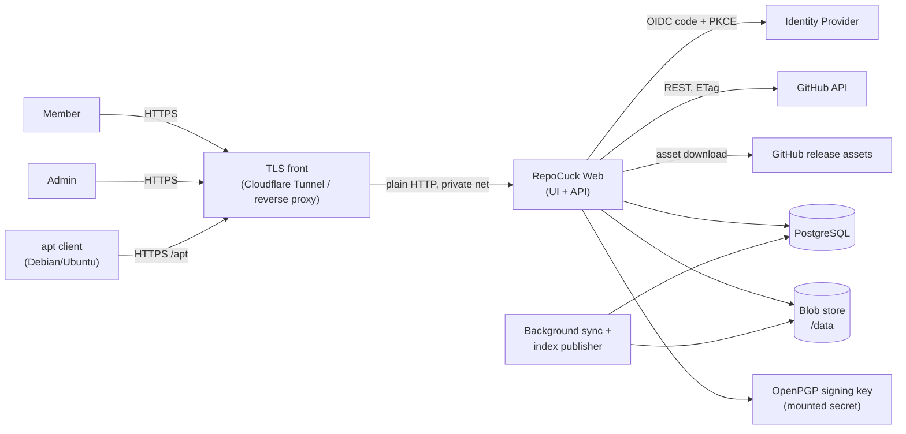

# RepoCuck — Product & Delivery Plan

| Field | Value |
| --- | --- |
| Status | v1.1 — implemented as RepoCuck 1.0 (see the spec's Appendix E for deviations) |
| Date | 2026-10-24 |
| Product name | RepoCuck |
| Companion document | [`IMPLEMENTATION_SPEC.md`](./IMPLEMENTATION_SPEC.md) |
| Target release | 1.0 (self-hosted, single-node reference deployment, homelab-first) |

Changes from v1.0: two roles (Admin / Member) instead of three; the watch list is fully
visible to everyone and members *request* additions; invisible-curation requirements removed;
HTTP/TLS model simplified to "plain-HTTP origin behind a TLS-terminating proxy or tunnel";
time estimates removed.

---

## 1. Summary

RepoCuck watches a curated list of GitHub repositories for releases, extracts the installable
Debian packages from those releases, and republishes them as **one signed APT repository**
that any Debian/Ubuntu host can consume with a normal `sources.list` line.

The watch list is shared and transparent: every signed-in user can see every watched
repository, its architectures, its sync status and the packages published from it. **Admins**
own the list. **Members** can request that a new repository be added, or that an additional
architecture be enabled for an existing one; an Admin approves or rejects the request.
Because a repository can only exist once, duplicates are impossible by construction and
requests for something already watched are answered plainly ("already watched").

The product is a .NET 10 web application shipped as a single container image with PostgreSQL,
supporting local accounts and OIDC/OAuth2 login with group-to-role mapping. The app is a
plain-HTTP origin intended to sit behind a reverse proxy or a Cloudflare Tunnel that provides
HTTPS; a LAN-only plain-HTTP mode is supported for homelabs.

### Why this exists

GitHub releases are where a lot of Linux tooling ships, but they are not an APT repository:
there is no signed `Release` file, no `Packages` index, no architecture filtering, and no
stable pool. Existing tools (aptly, reprepro, Gemfury, Cloudsmith) require someone to upload
and curate artefacts by hand. RepoCuck automates the chain from "GitHub repo publishes a
`.deb`" to "`apt-get install` works", while keeping a human approval gate on what gets
published under the operator's signing key.

---

## 2. Problem statement

| Pain | Consequence |
| --- | --- |
| `.deb` assets scattered across GitHub releases | Operators pin URLs, lose track of versions, and cannot upgrade with `apt` |
| Assets are unsigned at the APT level | Clients must use `trusted=yes`, defeating package integrity |
| Releases mix architectures | Users download the wrong package or script per-arch URLs by hand |
| Several people want the same tool | Nobody knows whether it is already mirrored; people re-add or mirror it separately |
| No record of *who* asked for *what* | Supply-chain risk: anyone can point the repo at a hostile fork |
| Ad-hoc mirror scripts | No retention, no garbage collection, no observability, no TLS story |

---

## 3. Goals and non-goals

### Goals

- **G1** — Maintain a signed APT repository that is a drop-in `deb` source for Debian and
  Ubuntu clients on the architectures the operator selects.
- **G2** — Make the watch list transparent to all users and let members propose changes
  without a ticket system: request → admin decision.
- **G3** — Guarantee one canonical entry per GitHub repository and at most one published
  variant per package identity; conflicts are visible, not hidden.
- **G4** — Offer both local accounts and OIDC/OAuth2 SSO with IdP-group-to-role mapping.
- **G5** — Enforce a two-role model (Admin / Member) with server-side authorisation on every
  operation.
- **G6** — Be safe by default: signed metadata, verified upstream digests, sanitised package
  metadata, a human approval gate, hardened container, security headers, rate limiting,
  audit log.
- **G7** — Deploy with one `docker compose up` behind a reverse proxy or Cloudflare Tunnel,
  with no build step on the host.

### Non-goals (1.0)

- Building packages from source, or repacking/modifying upstream `.deb` contents.
- RPM, Arch, Alpine or Homebrew repositories. (One Debian repository only.)
- A general-purpose artefact registry (no arbitrary file hosting, no `deb-src`).
- Multi-tenant organisations / per-team repositories. One instance = one repository.
- TLS termination inside the app. HTTPS is the proxy's or tunnel's job.
- CDN or global edge distribution beyond what a fronting proxy/tunnel already provides.
- HA clustering. One app instance plus one PostgreSQL. The design keeps a single-writer
  constraint explicit so HA can be added later.
- Anonymous *write* APIs. Everything mutating requires an authenticated session.
- Private GitHub repositories.

---

## 4. Users and roles

An account has exactly one role. OIDC group claims map onto these roles.

| Role | Intent | Can do | Cannot do |
| --- | --- | --- | --- |
| **Member** | Consumer / contributor | View all watched repositories, their architectures, sync status, releases and packages; **request** a new repository; **request** an additional architecture for an existing repository; view and cancel their own pending requests; manage their own profile, password and MFA | Approve or reject requests; edit repositories directly; see users, settings, audit log or signing configuration |
| **Admin** | Owner / operator | Everything a Member can, plus: add/edit/pause/remove/block repositories directly; approve or reject requests; set architectures, prerelease policy and asset filters; trigger syncs; manage users, roles, identity providers and group mappings; global settings, retention, signing keys; quarantine/delete packages; view the audit log | — (last-admin protection prevents self-lockout) |

Design notes:

- The list is shared. There is no per-user ownership of a watch entry; a request records who
  asked, and the repository record keeps the original requester for attribution.
- An Admin may approve a request they filed themselves. There is no separate "four-eyes"
  rule, which would deadlock single-admin homelabs. The audit log records both actors.
- Adding a repository that is already watched is not an error condition to hide: the API and
  UI say "already watched" and offer "request an additional architecture" instead.

---

## 5. Functional requirements

Requirement IDs are stable and are traced to design sections and tests in the implementation
spec.

### 5.1 Repositories (the shared watch list)

| ID | Requirement |
| --- | --- |
| FR-REPO-1 | Repositories are identified by `owner/name` or a pasted GitHub URL (HTTPS or SSH form). |
| FR-REPO-2 | The system resolves a repository through the GitHub API, stores the **numeric repository ID** as canonical identity, and rejects non-existent or non-public repositories. |
| FR-REPO-3 | Every authenticated user can list and view all repositories with state, architectures, prerelease policy, last sync outcome, releases and published packages. |
| FR-REPO-4 | Only Admins can add, edit, pause, resume, remove or block a repository. |
| FR-REPO-5 | A repository has a lifecycle state: `proposed` (requested, not yet approved), `active`, `paused`, `removed`, `rejected`, `blocked`. |
| FR-REPO-6 | Renames and transfers of upstream repositories are followed via the GitHub numeric ID; the display name is refreshed without breaking the watch. |
| FR-REPO-7 | Archived or deleted upstream repositories are surfaced as a stale state and stop consuming sync quota after a configurable number of failures. |
| FR-REPO-8 | A free-text description/notes field per repository is editable by Admins. |

### 5.2 Requests

| ID | Requirement |
| --- | --- |
| FR-REQ-1 | A Member (or Admin) can file an `add_repo` request with a repository reference, desired architectures and a note. |
| FR-REQ-2 | A Member can file an `add_arch` request for an existing `active` or `paused` repository, naming the architectures to add and a note. |
| FR-REQ-3 | Requests are visible to the requester and to Admins. Admins have a queue of pending requests grouped by repository. |
| FR-REQ-4 | An Admin approves a request (optionally adjusting the architectures) or rejects it with a reason. The requester sees the decision and reason. |
| FR-REQ-5 | A requester can cancel their own pending request. |
| FR-REQ-6 | An `add_repo` request for an already-watched repository is refused with a clear "already watched" response that links to the existing repository. A duplicate pending request by the same user is refused likewise. A request for architectures already enabled is refused as "already enabled". |
| FR-REQ-7 | A request for a `blocked` repository is refused. |
| FR-REQ-8 | Per-user limits cap pending requests and requests per hour. |
| FR-REQ-9 | A `proposed` repository is fetched and inspected in quarantine so the Admin can review real package metadata, but **nothing is published until approval**. |

### 5.3 Architecture targeting

| ID | Requirement |
| --- | --- |
| FR-ARCH-1 | Each repository has an architecture set chosen from an operator-configured allow-list (default `amd64`, `arm64`, `armhf`, `i386`, `riscv64`). |
| FR-ARCH-2 | The effective architecture set of the APT repository is the allow-list ∩ the union of the architecture sets of repositories that are published (`active`, `paused`, or `removed` within its grace period), plus `all`. |
| FR-ARCH-3 | Package architecture is authoritative from the `.deb` control file, never from the asset filename. |
| FR-ARCH-4 | `Architecture: all` packages are accepted regardless of the selected set and are published into every enabled architecture index. |
| FR-ARCH-5 | Packages whose architecture is not in the repository's set are never published; they are recorded as excluded, not as errors. Adding an architecture re-evaluates excluded assets. |
| FR-ARCH-6 | Advertise exactly the effective architecture set plus `all`; no index is generated for unselected architectures. |

### 5.4 Release ingestion

| ID | Requirement |
| --- | --- |
| FR-ING-1 | Poll each active repository on a per-repository schedule (default 30 min, jittered) and on demand for Admins. `proposed` repositories sync once when requested and on Admin demand. |
| FR-ING-2 | Ingest published, non-draft releases; prereleases only for repositories opted in by an Admin (prereleases publish to the `testing` suite). |
| FR-ING-3 | Identify installable assets by probing the `.deb` ar magic (`!<arch>\n`), not only by extension. Asset include/exclude globs are configurable per repository (default `*.deb`). |
| FR-ING-4 | Verify every downloaded asset against the GitHub-provided SHA-256 digest when present, and always compute and store our own SHA-256/SHA-512. Content-length mismatches abort the asset. |
| FR-ING-5 | Store accepted artefacts immutably, content-addressed, before they become part of an index. Upstream deletion never breaks the published repository. |
| FR-ING-6 | Parse the `.deb` control file in-process with bounded decompression; never install, execute or shell out to `dpkg`. |
| FR-ING-7 | Record the full sync outcome (counts, skips, failures, conflicts, duration) per repository and show it to every user. |
| FR-ING-8 | Survive GitHub rate limits (honour `X-RateLimit-Reset`, exponential backoff, conditional requests via ETag) and transient 5xx errors without losing progress. |
| FR-ING-9 | Optionally consume GitHub webhooks (release events) to trigger immediate syncs; polling remains the source of truth. |
| FR-ING-10 | Surface GitHub asset download counts for published packages when available (informational only). |

### 5.5 APT repository

| ID | Requirement |
| --- | --- |
| FR-APT-1 | Serve exactly one APT repository root (default `/apt`) with the `stable` suite and `main` component; an optional `testing` suite carries stable plus prerelease packages. |
| FR-APT-2 | Generate `Packages`, `Packages.gz`, `Packages.xz` per architecture with correct `Filename`, `Size`, `SHA256` and `SHA512` fields computed by us. |
| FR-APT-3 | Generate `Release` and a clearsigned `InRelease`, plus a detached `Release.gpg`, signed by an operator-controlled key. |
| FR-APT-4 | Publish `Acquire-By-Hash: yes` and keep previously published index blobs resolvable for a minimum time window and generation count. |
| FR-APT-5 | Refresh `Date`/`Valid-Until` on a daily heartbeat even when no content changed, so clients never hit an expired `Release`. |
| FR-APT-6 | Publish the repository signing public key at a stable URL in binary (`.gpg`) and armored (`.asc`) form for `signed-by=` usage. |
| FR-APT-7 | Support conditional GET (`If-None-Match`, `If-Modified-Since`), range requests for pool files, and correct `Content-Type`/`Content-Encoding`. |
| FR-APT-8 | Serve the public repository anonymously. Read restriction, if wanted, is applied by the fronting proxy or tunnel, not the app. |
| FR-APT-9 | Provide a copy-paste `sources.list.d` snippet, keyring install command and a recommended apt pin on a public landing page, parameterised by the configured public scheme/host. |
| FR-APT-10 | `apt-get update`, `apt-get install`, `apt-get download pkg:arm64` (with the foreign architecture enabled) and `apt-get upgrade` must succeed against the repository on stock Debian 12 and Ubuntu 24.04 clients. |

### 5.6 Curation

| ID | Requirement |
| --- | --- |
| FR-CUR-1 | There is exactly one canonical repository record per GitHub repository ID. |
| FR-CUR-2 | A package identity is `(name, version, architecture)` within the repository; at most one active variant may be published for that identity. |
| FR-CUR-3 | When two sources produce the same package identity, one is selected deterministically (first source wins, then Admin source priority); the other is retained as an alternate and never published. |
| FR-CUR-4 | Identity conflicts are visible to all users on the repository page (which repositories also offer this package/version) and to Admins in a conflicts view. |
| FR-CUR-5 | Package *versions* are not "deduplicated" — multiple versions of the same package remain installable subject to retention policy. |
| FR-CUR-6 | An Admin can set a per-repository source priority and re-arbitrate affected packages. |
| FR-CUR-7 | Repositories on the Admin blocklist cannot be requested or re-added. |
| FR-CUR-8 | Packages that match the reserved-name list (distro-critical names), carry an epoch ≥ 1 where the policy forbids it, or otherwise trip policy checks are held in `quarantined` state until an Admin explicitly releases them. |

### 5.7 Accounts, authentication, authorisation

| ID | Requirement |
| --- | --- |
| FR-AUTH-1 | Local accounts with username/password, optional TOTP second factor and one-time recovery codes. |
| FR-AUTH-2 | OIDC authorisation-code flow with PKCE against one or more configured providers. |
| FR-AUTH-3 | Map IdP group claims to RepoCuck roles through ordered, admin-managed rules; highest matched role wins. |
| FR-AUTH-4 | JIT-provision OIDC users on first login as Member; never auto-provision Admin except via an explicit admin-defined mapping. |
| FR-AUTH-5 | Accounts are linked by `(provider, subject)`. Linking by email is off by default; a user may explicitly link a provider from their profile after re-authentication. |
| FR-AUTH-6 | Local login can be disabled; at least one enabled Admin must always remain (guard against lockout). |
| FR-AUTH-7 | Sessions use `HttpOnly` cookies — `__Host-`/`Secure` when the public scheme is HTTPS — `SameSite=Lax`, sliding idle expiry and absolute lifetime; logout performs RP-initiated logout when the provider supports it. |
| FR-AUTH-8 | Password login is rate-limited per IP and per account with lockout; authentication failures are audited without logging secrets. |
| FR-AUTH-9 | Role changes from OIDC take effect on next login/token refresh; manually pinned roles (`role_locked`) are not overwritten. |

### 5.8 Administration and operations

| ID | Requirement |
| --- | --- |
| FR-ADM-1 | Admin UI/API for users (create, disable, reset password, set role, unlock), identity providers and group mappings. |
| FR-ADM-2 | Admin controls for suite enablement, architecture allow-list, retention, sync intervals, asset size caps, reserved-name list and request limits. |
| FR-ADM-3 | Signing key lifecycle: generate-or-import, show fingerprint and expiry, export public key, rotate with overlap window. |
| FR-ADM-4 | Append-only audit log of privileged and decision actions, exportable by Admins. |
| FR-ADM-5 | Manual package/variant quarantine and deletion (soft-delete first, GC later). |
| FR-ADM-6 | Health endpoints, structured logs, metrics and traces for operations. |
| FR-ADM-7 | Bootstrap path for the first Admin (environment-provided or one-time setup token, forced password change). |

### 5.9 Deployment

| ID | Requirement |
| --- | --- |
| FR-DEP-1 | Single OCI image, non-root, read-only-root-filesystem compatible, with a `/data` volume for blobs, keys and data-protection material. |
| FR-DEP-2 | `docker compose` reference stack: app + PostgreSQL + one of `cloudflared` (Cloudflare Tunnel) or Caddy as the HTTPS front. |
| FR-DEP-3 | Configuration exclusively through environment variables and a mounted config file; no rebuild required to change settings. |
| FR-DEP-4 | Database migrations applied on startup under an advisory lock, or via a separate migration command/init container. |
| FR-DEP-5 | The app listens on plain HTTP only. `Security__PublicScheme=https` (default) assumes a TLS-terminating front, trusts forwarded headers from configured proxies only, and emits secure cookies and HSTS. `PublicScheme=http` supports LAN-only deployments with a startup warning. |
| FR-DEP-6 | Real client IP is taken from a configurable header (`X-Forwarded-For` or `CF-Connecting-IP`) honoured only when the immediate peer is a trusted proxy. |
| FR-DEP-7 | Graceful shutdown: in-flight downloads and index publication either complete or roll back; no partially published generation. |

---

## 6. Non-functional requirements

| ID | Area | Target |
| --- | --- | --- |
| NFR-SEC-1 | Security | OWASP ASVS 5.0 Level 2 as the baseline for authentication, session, access control, validation and logging. |
| NFR-SEC-2 | Supply chain | Base images pinned by digest, NuGet lock files, Dependabot, SBOM, reproducible build flags. |
| NFR-SEC-3 | Crypto | TLS 1.2+ at the front (1.3 preferred), SHA-256/512 digests, OpenPGP SHA-512 signature digest, no MD5 in generated metadata, PBKDF2-SHA256 ≥ 600k iterations (or Argon2id). |
| NFR-PERF-1 | Latency | `Packages` index served < 150 ms p95 for 10k packages; pool download limited by disk/network, not CPU. |
| NFR-PERF-2 | Throughput | 200 concurrent index requests and 50 concurrent large downloads on 2 vCPU / 2 GB without errors. |
| NFR-SCALE-1 | Capacity | 2,000 watched repos, 20k package variants, 200 GB pool on a single node. |
| NFR-REL-1 | Durability | Published pool files immutable; index publication atomic; no client-visible partial state. |
| NFR-REL-2 | Availability | 99.5 % monthly for the APT read path (single node, restartable). |
| NFR-OBS-1 | Observability | OpenTelemetry traces/metrics, JSON logs with correlation IDs, `/healthz` + `/readyz`, audit trail. |
| NFR-OPS-1 | Operability | Backup/restore documented and tested; key rotation and DB restore rehearsed. |
| NFR-MAINT-1 | Maintainability | Modular monolith, ≥ 70 % line coverage on domain and Debian-generation code, golden-file tests for index output. |
| NFR-UX-1 | Accessibility | WCAG 2.2 AA for the management UI; keyboard-operable; no JS required for core flows. |
| NFR-COMPAT-1 | Client compatibility | Debian 11/12/13, Ubuntu 22.04/24.04, `apt` ≥ 2.2. |
| NFR-COMPAT-2 | Browser support | Current Firefox, Chrome, Safari, Edge. |
| NFR-COMPAT-3 | Front compatibility | Works behind Caddy/nginx/Traefik and Cloudflare Tunnel (`cloudflared`) with the documented header and caching configuration. |

---

## 7. Architecture

### 7.1 System context

### 7.2 Runtime components

| Component | Responsibility |
| --- | --- |
| Web host (ASP.NET Core) | Razor Pages UI, JSON API, cookie/OIDC authentication, APT read endpoints, health, security headers |
| Sync worker (hosted service) | Claims jobs from the DB queue, drives GitHub ingestion, parses `.deb`, writes blobs and package rows |
| Index publisher | Debounced/queued generation of `Packages`/`Release`, signing, generation pointer swap |
| Maintenance worker | ETag housekeeping, retention/GC, daily `Release` heartbeat, stale repo detection |
| PostgreSQL | Authoritative state, job queue (`FOR UPDATE SKIP LOCKED`), audit records |
| Blob store | Immutable content-addressed `.deb` files and generated index blobs (local filesystem in 1.0) |

Deployment is a **modular monolith**: one image, one process (`ROLE=all`). A `web`/`worker`
split exists for experimentation but requires a shared `/data` volume and is not a supported
1.0 topology; the index publisher holds a PostgreSQL advisory lock so only one writer can
publish at a time.

### 7.3 Primary data flow

1. A Member files an `add_repo` request → GitHub lookup → canonical repository row created in
   state `proposed` (or the request is refused as "already watched" / "blocked").
2. A one-off quarantine sync fetches the latest few releases so the Admin can inspect parsed
   package metadata. Nothing from a `proposed` repository is published.
3. An Admin approves (choosing architectures) → repository becomes `active` → scheduler
   enqueues `SyncRepository` jobs. Worker fetches releases (ETag), verifies digests, parses
   control metadata, stores blobs, upserts `package_variants`.
4. Arbitration resolves duplicate package identities; policy checks may quarantine variants.
5. Index publisher builds a new immutable generation for each affected suite, signs it, and
   flips the `apt_current` pointer in one transaction.
6. `apt` fetches `InRelease` → `Packages` (or `by-hash`) → pool files. All read paths are
   public and cache-friendly.

---

## 8. Key technical decisions (summary)

| Decision | Choice | Why | Alternatives rejected |
| --- | --- | --- | --- |
| Runtime | .NET 10 LTS, ASP.NET Core | Current LTS, container-friendly, strong crypto/HTTP stack | Node, Go (rewrite cost vs team skills) |
| UI | Razor Pages + minimal APIs, server-rendered | Small attack surface, CSP-friendly, no SPA build chain | Blazor Server, React SPA |
| Database | PostgreSQL 17+ | Advisory locks, `SKIP LOCKED`, `citext`, JSONB, arrays | SQLite, SQL Server |
| Job queue | DB-backed table + worker loop | No extra infrastructure; transactional with domain writes | Hangfire, RabbitMQ |
| GitHub client | Typed `HttpClient` + `System.Text.Json` | Full control of ETag, digests, pagination, rate limits | Octokit |
| `.deb` parsing | Custom `ar` reader + `System.Formats.Tar` + bounded decompression | No external binaries for parsing, testable | shelling out to `dpkg-deb` |
| Signing | `gpg` CLI in the runtime image, key on the data volume | Spec-correct clearsign, multi-key rotation | BouncyCastle |
| Index publication | Immutable generations in blob store + DB pointer + `Acquire-By-Hash` | Atomic, race-free | Direct `dists/` writes |
| Identity | Custom local auth + OIDC handlers | Minimal surface | Full ASP.NET Identity |
| TLS | Terminated by a proxy/tunnel; app is plain HTTP | Matches homelab reality and Cloudflare Tunnel; avoids certificate handling in the app | In-app Kestrel TLS |
| Roles | Admin / Member, shared transparent list, request workflow | Simple mental model; no hidden state to leak or test | Per-user private lists, moderator tier |
| Config | Env vars + mounted `appsettings.json`, DB-backed runtime settings | 12-factor + live operational changes | Rebuild-to-change config |

Detailed rationale and diagrams: `IMPLEMENTATION_SPEC.md` §2, §4, §7, §8, §12.

---

## 9. Delivery plan

Milestones are ordered by dependency; no durations are committed.

| Milestone | Scope | Exit criteria |
| --- | --- | --- |
| **M0 — Foundations** | Solution skeleton, CI, Dockerfile, compose, config binding, EF Core + migrations, health endpoints, local auth + two-role model, audit scaffolding, security headers, proxy/forwarded-header handling | `docker compose up` serves a login page behind the sample proxy and in `PublicScheme=http` LAN mode; migrations apply; login/logout works; CI green |
| **M1 — Ingestion** | GitHub client (ETag, pagination, rate limits), admin repository CRUD, job queue with leases, sync runs, `.deb` fetch + digest verification + bounded parsing, blob store | A configured repo's `.deb` assets are stored and displayed with parsed control metadata; failures are retried and visible |
| **M2 — APT publishing** | Index generation, signing, generation pointer, by-hash, HTTP semantics, public landing page, apt E2E harness; interim admin-only "activate repository" | `apt-get update && apt-get install` succeeds from a container against a signed repo for amd64 and arm64 |
| **M3 — Requests & curation** | Member UI, request workflow (add repo / add arch), admin queue, quarantine-sync for proposed repos, arbitration and conflicts view, reserved-name quarantine, blocklist | Members request; admins approve; duplicate requests are refused clearly; no duplicate `Packages` stanzas; nothing from `proposed` repos is published |
| **M4 — SSO** | OIDC providers (multi), PKCE, JIT provisioning, group mapping UI/API, account linking, TOTP for local, RP-initiated logout | Login via a reference IdP (Keycloak and Entra ID) yields correct roles from group claims; role changes apply on next login |
| **M5 — Hardening & ops** | Retention/GC, key rotation, backup/restore, rate limiting, CSP, observability, Cloudflare Tunnel validation, load test, runbooks | Security checklist signed off; restore drill passes; p95 index latency target met; full E2E passes through a tunnel |
| **M6 — 1.0** | Documentation, upgrade/migration story, SBOM, release image, acceptance test pass | All AC-* criteria pass; release notes published |

M4 depends only on M2 and may proceed alongside M3.

### Definition of done (per milestone)

- Code reviewed, tests added (unit + the relevant integration slice), no high-severity
  analyser or dependency warnings.
- Migration is reversible or has a documented forward-fix.
- Security-relevant changes have a threat-model note in the PR.
- Docs updated: configuration reference, runbook, changelog entry.
- Container image builds reproducibly and passes the smoke test.

---

## 10. Risks and mitigations

| # | Risk | Likelihood | Impact | Mitigation |
| --- | --- | --- | --- | --- |
| R1 | GitHub API rate limits or outages stall sync | High | Medium | Conditional requests, token with 5k/h, per-repo backoff, resume from last release, jittered jobs, webhook fast path |
| R2 | Upstream deletes or replaces an asset | Medium | Medium | Content-addressed immutable copies; never re-fetch published blobs; a changed digest is stored as an alternate and never replaces published bytes |
| R3 | Malicious or malformed `.deb` compromises the host or clients | Medium | High | No execution, bounded parsing, size/ratio caps, metadata sanitisation, quarantine-before-approval, reserved-name and epoch policy, optional release holdback, quarantine/blocklist, admins can unpublish |
| R4 | Compromised or hostile upstream pushes a malicious update after approval | Low | Critical | Approval is per repository, so add: optional holdback window, audit of every new variant, new-package-name notifications in the UI, recommended client apt pin (priority below distro), fast unpublish |
| R5 | Duplicate package names across forks corrupt indices | Medium | High | Deterministic arbitration, one active variant per identity, `Packages` uniqueness invariant, visible conflicts view, source priority |
| R6 | Signing key loss, compromise or silent expiry | Low | Critical | Key backup procedure, rotation with overlap, key not in image, passphrase via secret, expiry alert, fingerprint documented |
| R7 | `Release` expiry breaks `apt update` | Medium | High | Daily heartbeat regeneration, `Valid-Until` alert, generation health metric |
| R8 | Disk exhaustion from unbounded asset growth | Medium | High | Per-asset cap, retention per package, orphan grace + GC, capacity alerts |
| R9 | OIDC misconfiguration locks everyone out | Medium | High | Local admin fallback, last-admin guard, provider "test" action, offline CLI recovery |
| R10 | Mis-set proxy/tunnel headers break rate limits, cookies or redirect behaviour | Medium | Medium | Startup validation, documented per-front configuration, `PublicScheme` and `ClientIpHeader` settings, E2E through a tunnel |
| R11 | CDN/tunnel caching or terms-of-service issues for large binary downloads | Medium | Medium | Documented cache rules; uncached metadata; note on provider terms; LAN-only mode as alternative |
| R12 | Redistributing binaries violates licences | Medium | Medium | Operator responsibility, licence metadata captured and displayed, docs warning, per-repo block |
| R13 | Single-node availability | Medium | Medium | Fast restart, health checks, documented restore; HA explicitly post-1.0 |
| R14 | apt client caching/atomicity edge cases | Medium | Medium | `Acquire-By-Hash`, time- and count-based generation retention, E2E with real `apt` under concurrent updates |
| R15 | Scope creep into a general registry | High | Medium | Non-goals enforced in review; new formats require a new spec |

---

## 11. Open questions

1. **Licensing/compliance policy** — block repositories without a detected licence, or warn?
   Default proposal: warn, record SPDX, let Admins block.
2. **Release holdback default** — default is 0 (publish immediately). Should homelab defaults
   hold new releases for e.g. 24 h to reduce exposure to compromised upstream releases?
3. **Reserved-name list source** — ship a static list of distro-critical names, or let the
   Admin import `Packages` indices from Debian/Ubuntu mirrors? Proposal: both.
4. **Prerelease semantics** — per-repository Admin opt-in publishing to `testing`.
5. **Retention defaults** — 3 versions per package, 30-day orphan grace proposed.
6. **Package signing beyond apt** — verify upstream `deb` signatures (rarely present) or only
   digests? Proposal: digests only, document the trust boundary.
7. **Notification channel** — out of scope for 1.0 (no emails). Webhook/Matrix/email digest
   for request decisions later?
8. **Namespace/product naming** — `RepoCuck` is the working name; confirm before image and
   package publication.

---

## 12. Success metrics

| Metric | Target |
| --- | --- |
| Time from "request approved" to "package installable" | < 15 min p95 (first sync, or immediate if quarantine sync already ingested it) |
| `apt-get update` success rate against the repo | > 99.9 % |
| Duplicate package identities published | 0 (alert on any) |
| Requests decided without needing a follow-up question | > 90 % |
| Index generation duration (5k packages) | < 10 s p95 |
| Sync job failure rate | < 2 % (excluding upstream 404s) |
| Security findings open at release | 0 high/critical |

---

## 13. Assumptions and constraints

- GitHub remains the only upstream source in 1.0; only **public** repositories are supported.
- Clients reach the instance over HTTPS via a reverse proxy or Cloudflare Tunnel; plain HTTP
  is supported for trusted LAN-only deployments (APT metadata is signed regardless).
- The operator controls DNS, TLS termination (or tunnel) and backups.
- One instance owns one APT repository and one signing identity.
- PostgreSQL is the only supported database.
- The mirroring operator is responsible for complying with upstream licences.
- Asset downloads are limited to GitHub-controlled hosts; arbitrary URL ingestion is out of
  scope.
- The instance is not a build service: only release assets that are already `.deb` files are
  mirrored.
- The application itself is proposed under the MIT licence; mirrored binaries retain their
  upstream licences and are not relicensed by RepoCuck.
